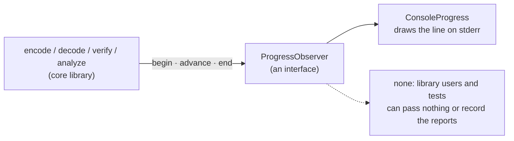
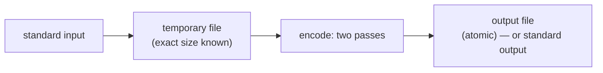

# Using bardzip from the command line

[Docs index](../README.md) · [Overview](overview.md) · [Helper commands](commands.md) · [Windows integration](windows.md) · 🇷🇺 [Русская версия](../ru/cli.md)

Everything that makes `bardzip` pleasant in a terminal and safe in scripts: a progress line, `--quiet` / `--verbose`, exit codes, pipes, and tab completion.

## Progress line

While a long operation runs **and stderr is a console**, a single line is rewritten on the screen:

```text
Writing poem  42%  1.2 GiB written  ~40 s left
```

| Operation | Stages shown |
|---|---|
| `encode` | `Reading` (the input, with compression) → `Writing poem` (the long part: the poem is ~54× the data) |
| `decode`, `verify` | `Reading poem` → `Restoring file` |
| `preview`, `estimate` | `Analyzing` |
| `-` as input | `Receiving input` (copying standard input to a temporary file; the total is unknown, so only the amount is shown) |

Rules:
- It is shown **only on a console**. When stderr is redirected to a file or a pipe, or with `--quiet`, nothing is printed, so logs stay clean.
- It goes to **stderr**, never to stdout, so it cannot mix with the result of a pipe.
- The line is **erased** when a stage ends, and also before an error message, so it never mixes with other output.
- The time left appears once 1 % is done and the stage has run for a second; the screen is refreshed at most ten times a second, so printing never slows the work.



The core library never prints: it only reports to an optional `ProgressObserver`. The tests record the reports and check that the stages come in the right order, that the position never goes back, that it ends at the total, and that every stage is closed even when an operation fails.

## `--quiet` and `--verbose`

Both work with every command (`-q` / `-v`); using them together is an error.

| | `--quiet` | normal | `--verbose` |
|---|---|---|---|
| progress line | no | on a console | on a console |
| `encode` report (stderr) | no | yes | yes |
| `Verification successful.` | no | yes | yes |
| timings and settings | no | no | yes: what is encoded where, the limits, time and MiB/s |
| error messages | **yes** | yes | yes, plus `[exit code 4: bad data]` |
| results you asked for (`preview`, `estimate`, `inspect`, `identify`) | **yes** | yes | yes |

In short: `--quiet` leaves only errors and the results themselves — handy in scripts, where the exit code tells whether it worked.

## Exit codes

| Code | Meaning | Examples |
|---:|---|---|
| 0 | success | |
| 1 | internal error | a bug, out of memory |
| 2 | wrong usage | unknown option, missing `-o`, `--quiet` with `--verbose`, binary data to a terminal |
| 3 | file or system problem | cannot open or write, output exists (use `--force`), the output is the input, disk full |
| 4 | bad data | not a poem, damaged, checksum or size mismatch, unsupported version |
| 5 | limit exceeded | `--max-input`, `--max-output` |

```text
bardzip verify photo.poem --quiet
switch ($LASTEXITCODE) {
    0 { "intact" }
    4 { "damaged or not a poem" }
    default { "could not check (code $LASTEXITCODE)" }
}
```

Errors are typed inside the program (`UsageError`, `LimitError` and the standard exception types) and turned into a code in one place, [exit_codes.cpp](../../src/cli/exit_codes.cpp); tests check that real failures give the documented codes.

## Pipes: standard input and output

Use `-` where a file name is expected.

```text
type photo.zip | bardzip encode - -o - | bardzip decode - -o - > copy.zip
bardzip encode photo.zip -o - | bardzip verify -
bardzip encode - -o photo.poem < photo.zip
bardzip decode photo.poem -o - > restored.zip
```

| Where | `-` means |
|---|---|
| input of `encode`, `preview`, `estimate` | read standard input |
| input of `decode`, `verify`, `inspect`, `identify` | read the poem from standard input |
| `-o -` of `encode` | write the poem to standard output |
| `-o -` of `decode` | write the restored bytes to standard output |

Things to know:
- **Standard input is first copied to a temporary file.** The encoder needs the exact size and reads its input twice (once to measure and compress, once to write the poem). The copy honours `--max-input` while it is received, and is deleted afterwards, also on errors. So `encode -` needs disk space for the copy.
- **Decoding to a terminal is refused** (exit code 2): restored data is binary. Redirect it (`> file`, or `|` to another program) or use `-o file`.
- Nothing but the result goes to stdout when `-o -` is used: reports and the progress line go to stderr. Streams are switched to binary mode, so no line-break translation happens and Ctrl+Z does not end the input.
- `--quick` cannot be used with `-` (the size of a stream is not known).
- A file that is really called `-` can be given as `.\-`.



## PowerShell tab completion

```text
bardzip completion powershell | Out-String | Invoke-Expression
```

Add that line to your profile (`notepad $PROFILE`) to have it in every session. Then <kbd>Tab</kbd> completes commands, options and the values of `--compression`; file names are completed by PowerShell as usual:

```text
bardzip en<Tab>                       →  encode
bardzip encode --c<Tab>               →  --compression
bardzip encode in -o out --compression z<Tab>   →  zstd
bardzip completion <Tab>              →  powershell
```

The script is **generated from the same table of commands and options** that a test compares with the real argument parser, so the completion cannot silently drift from the program.
