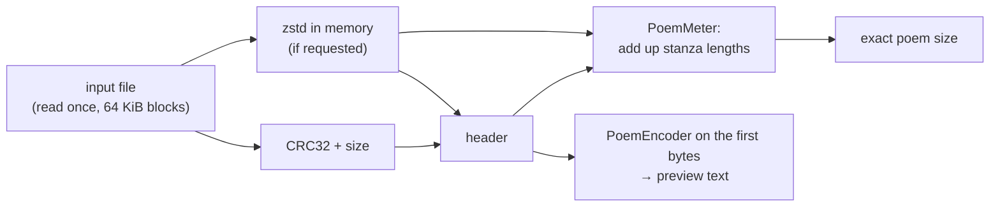
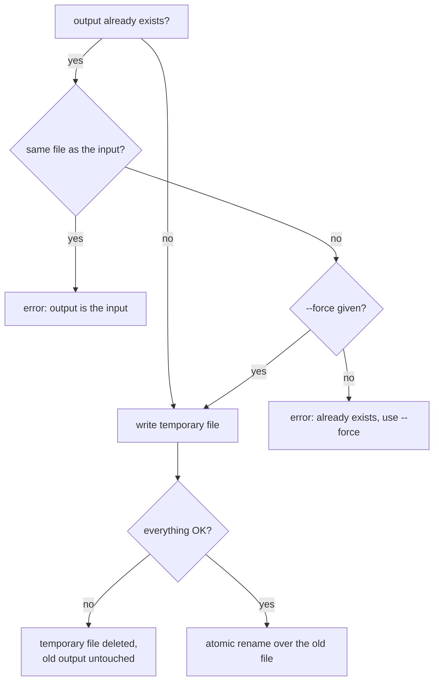

# Helper commands: preview, estimate, identify and --force

[Docs index](../README.md) · [Overview](overview.md) · [Main flow](main-flow.md) · [Streaming](streaming.md) · [RAII](raii.md) · 🇷🇺 [Русская версия](../ru/commands.md)

Four small additions around `encode` / `decode`. None of them changes the poem format, and the three new commands never write anything.

## `preview` — "what would my file look like?"

Shows the first stanzas of the poem that `encode` would write, plus the **exact** total size, without creating the (possibly gigabyte-sized) file.

```text
bardzip preview photo.png --stanzas 4
```

```text
BARDZIP-POEM 1 DICT 1

бледный протокол
оплакивает квитанцию.
четверг не наступил.
...
... 160 more stanzas ...
Poem size: 17,561 bytes (17.1 KiB) (exact), compression: zstd
```

The poem text goes to **stdout** (so `> head.txt` works), the notes to stderr. The first 18 stanzas are the container header (they describe the file: sizes, checksums), after that the stanzas carry the data itself. `--stanzas <n>` accepts 1–10,000 (default 6); `--compression` works as in `encode`.

## `estimate` — "will it fit on my disk?"

```text
bardzip estimate photo.png
bardzip estimate photo.png --quick
bardzip estimate big.zip -o D:\out\big.poem
```

| Mode | How | Result |
|---|---|---|
| **exact** (default) | reads the file once, compresses it in memory if the mode asks for it, and adds up the length of every stanza | the exact poem size in bytes, labelled `EXACT` |
| **`--quick`** | looks only at the file size | a range (`smallest … largest`) and a typical value, labelled `APPROXIMATE`; assumes no compression and random data |

```text
Size:             2,016 bytes (2.0 KiB)
Compression:      none
Container:        2,052 bytes (2.0 KiB)
Stanzas:          1,026
Poem size:        109,361 bytes (106.8 KiB) - EXACT
Input limit:      within the limit of 16.0 MiB
Free disk space:  106.2 GiB on the volume of C:\...\BardZip
Result:           enough space
```

Why a range: the text of a stanza depends on the data (the 16 words of a dictionary have different lengths), so from the file size alone only bounds and an average can be given. The exact mode counts the real words.

Also reported: whether the input is within `--max-input` (and what to pass if it is not) and the free space on the disk of the output (`-o <path>`, default: the current folder). When zstd is used, the temporary compressed copy next to the output is included in the space needed. `estimate` does not enforce the input limit: it tells you about it.



`preview` and `estimate` share this one analysis, which is guaranteed to match the real encoder: the tests encode files in every mode and compare sizes, stanza counts and the first stanzas byte for byte.

## `identify` — "what is hidden inside?"

```text
bardzip identify riddle.poem
```

```text
Hidden file:      2,016 bytes (2.0 KiB), stored without compression
Looks like:       PNG image (.png)
First bytes:      89 50 4E 47 0D 0A 1A 0A 00 00 00 0D 49 48 44 52

This is a guess from the first bytes; the poem was not verified. ...
```

It reads only the **beginning** of the poem: the first 32 bytes of the hidden file (for a zstd payload just enough of the stream is decompressed) and compares them with well-known "magic numbers". Recognised: PNG, JPEG, GIF, WebP, BMP, TIFF, ICO, PDF, ZIP (also `.docx`, `.xlsx`, `.jar`, `.apk`), 7z, RAR, gzip, bzip2, xz, zstd, SQLite, MP3, MP4/MOV, WAV, AVI, Ogg, FLAC, Matroska, old Office documents, `.exe`/`.dll`, ELF, RTF, plus "plain text (UTF-8)" and "unknown binary data".

Things to know:
- It is a **guess**: a few formats share a signature, and a file can start like one format and be another.
- It does **not verify** the poem (damage after the first stanzas goes unnoticed). Use `verify` for that, then `decode -o file.<ext>`.
- It is a separate command on purpose: `decode` never tells what is inside, so a poem can still be a riddle.

## `--force` — replace an existing output

```text
bardzip encode photo.png -o photo.poem --force
```

Without `--force`, `encode` and `decode` refuse to touch an existing output file. With it, the old file is replaced **only after the new one has been written completely** (the same temporary-file mechanism as before, see [RAII](raii.md)): if anything fails halfway, the old file is still there, untouched.



The output can **never be the input file itself**, even with `--force`, in any spelling of the path (`dir\..\dir\file`): the input is still being read while the result is written. If the destination is open in another program, Windows refuses the replacement and the command fails with an error, leaving the old file in place.
