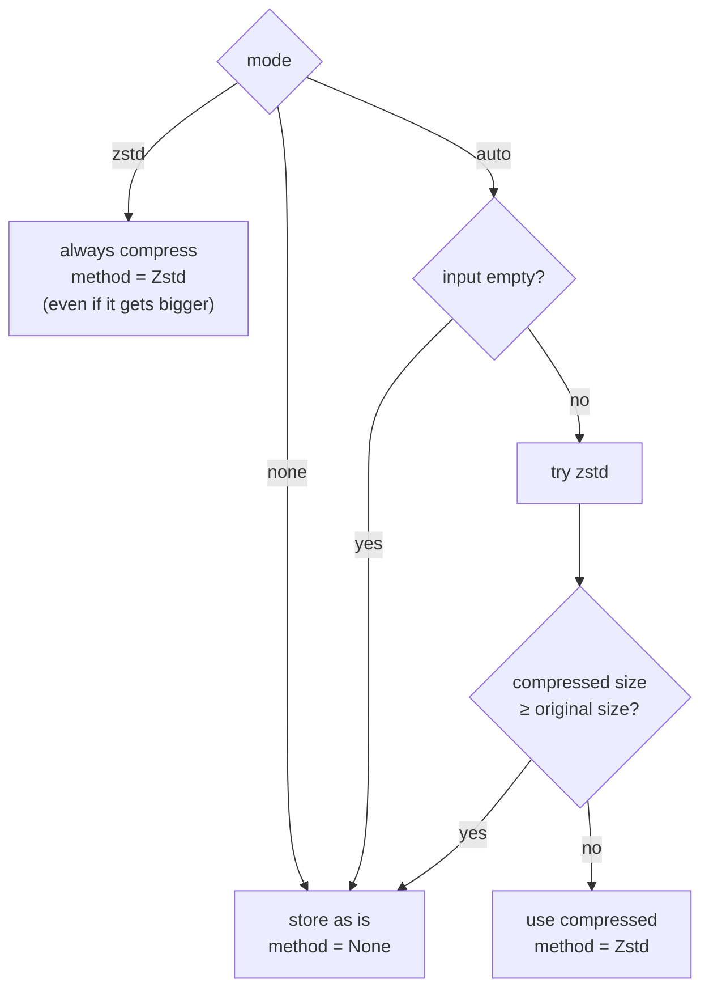
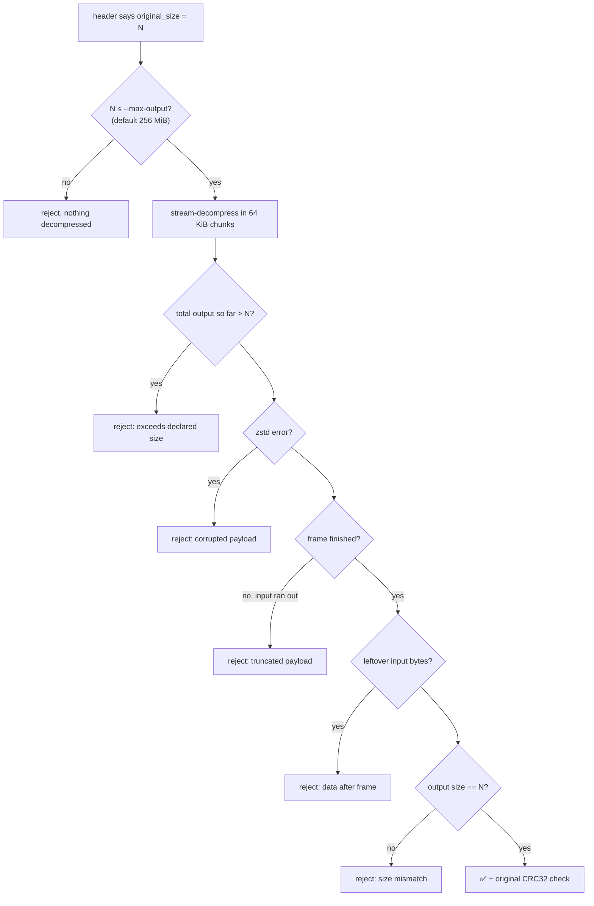
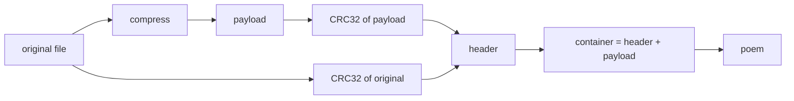

# Compression

[Docs index](../../README.md) · [Overview](overview.md) · [Main flow](main-flow.md) · [RAII](raii.md) · [CRC32](crc32.md) · [Streaming](streaming.md) · 🇷🇺 [Русская версия](../ru/compression.md)

## In plain words

Compression makes data **smaller** by exploiting repetition. The text "ha ha ha ha ha ha" can be stored as "'ha ' × 6". Real compressors do this cleverly for any kind of data, and later restore the original **exactly** (lossless).

Why it matters here: a poem is about **50× larger** than its data, so every byte saved before encoding saves ~50 bytes of poem.

BardZip uses **zstd** (Zstandard, by Facebook/Meta) — a fast, modern compressor — through its official C library, at level 3 (a good balance between speed and size). Code: [compression.cpp](../../src/compression/compression.cpp).

## Modes and methods

There are two different concepts:

| | Values | Where |
|---|---|---|
| **Mode** — what the *user asks for* | `none`, `zstd`, `auto` (default) | `--compression` option |
| **Method** — what was *actually used* | `0 = None (stored)`, `1 = Zstd` | recorded in the header, byte 5 |

`auto` therefore **never makes the payload bigger**: incompressible data (already‑compressed photos, zip files, random bytes) and tiny inputs are stored as they are. The decoder doesn't care which mode was requested — it simply reads the method from the header.

## Compress

`ZstdCompressor` ([compression.cpp](../../src/compression/compression.cpp)) takes the data in blocks (`write`) and hands compressed bytes to a callback as they appear; `finish()` closes the frame. The exact source size is announced up front, so it is stored in the frame header. Any library error becomes an exception. See [Streaming](streaming.md).

## Decompress — safely

Decompression of untrusted input is dangerous: a malicious tiny file may claim to expand into gigabytes (a *decompression bomb*). BardZip's defences:

- The zstd context is held by a `unique_ptr` with a custom deleter, so it is always freed ([RAII](raii.md)).
- For `None`, the payload size must equal the original size exactly.
- The header validator also enforces: for `None`, `original_size == payload_size` and equal CRCs; for `Zstd`, the payload must not be empty.

All these cases have tests in [compression_tests.cpp](../../tests/compression_tests.cpp) and [container_tests.cpp](../../tests/container_tests.cpp).

## Where compression sits in the pipeline

Both CRCs are calculated at encode time: one for the original (final check after decompression) and one for the payload (check before decompression) — see [CRC32](crc32.md).

## Practical tips

| Your data | Suggested mode |
|---|---|
| Text, source code, logs, documents | `auto` (will pick zstd) |
| JPG, PNG, ZIP, MP4 (already compressed) | `auto` (will store as is) |
| You want predictable, minimal processing | `none` |
| You want zstd regardless of benefit | `zstd` |
