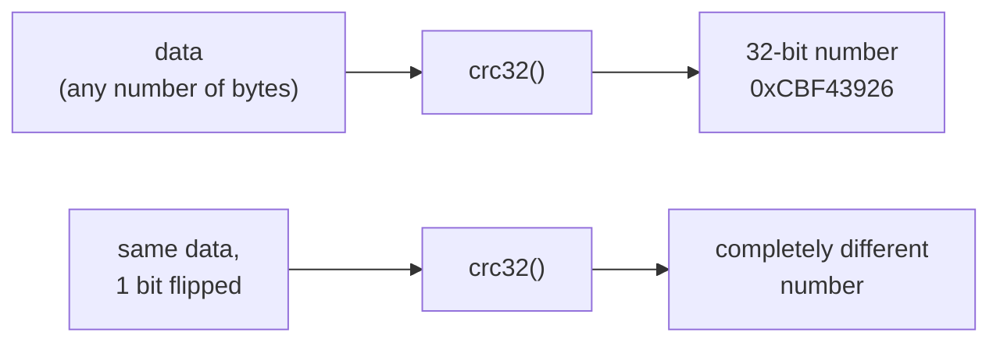
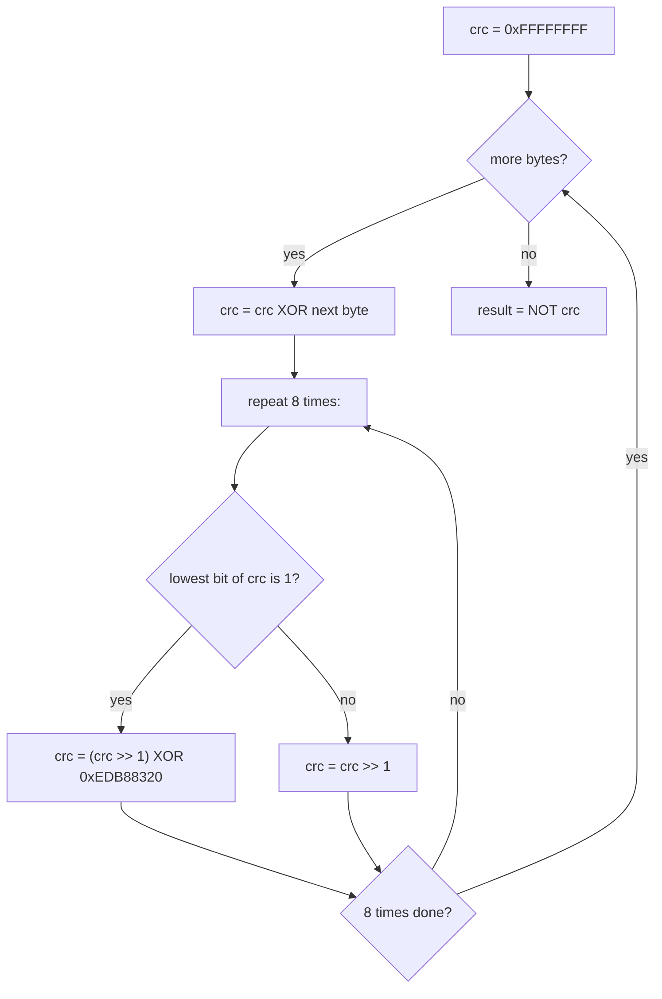
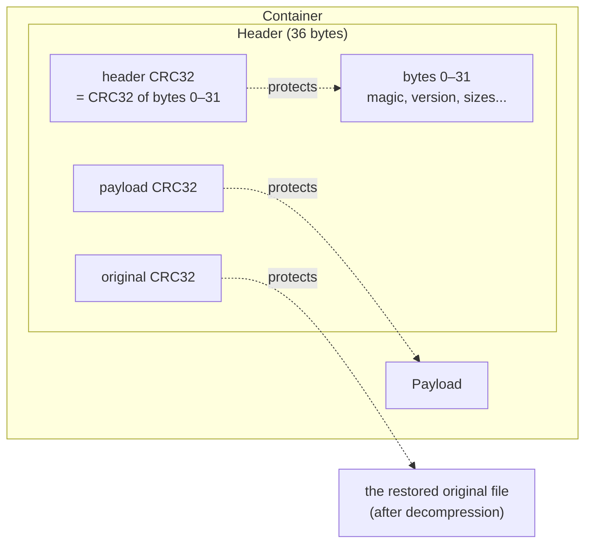
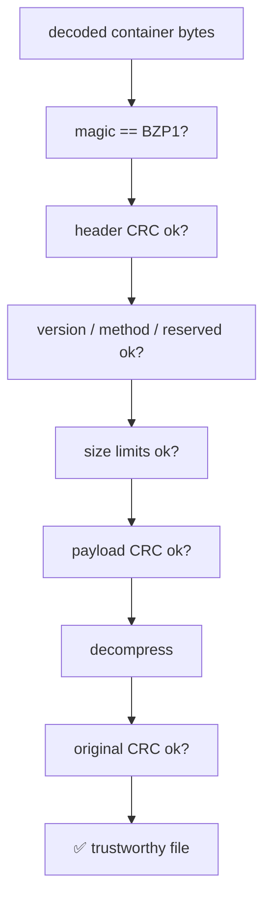

# CRC32 — a fingerprint for data

[Docs index](../README.md) · [Overview](overview.md) · [Main flow](main-flow.md) · [RAII](raii.md) · [Compression](compression.md) · [Streaming](streaming.md) · 🇷🇺 [Русская версия](../ru/crc32.md)

## In plain words

When you send a parcel you might write its weight on the box. If the weight at arrival differs, something was added or removed. A **checksum** is like that, but much more sensitive: a short number (here 32 bits, shown as 8 hex digits like `0xCBF43926`) calculated from **all** the bytes of the data. Change even one bit anywhere and the number changes (with overwhelming probability).

**CRC32** (*Cyclic Redundancy Check, 32 bit*) is the well‑known way of computing such a number; the same one is used in ZIP, PNG, Ethernet and many other formats.

> CRC32 detects **accidental** damage (typos, truncation, disk/transfer errors). It is **not** protection against a deliberate attacker — anybody can recompute a matching CRC. BardZip never claims otherwise.

## The implementation

[crc32.cpp](../../src/container/crc32.cpp) is only a few lines — the classic bit‑by‑bit algorithm, variant **CRC‑32/ISO‑HDLC** (polynomial `0xEDB88320` in reflected form, start value `0xFFFFFFFF`, final inversion):

Intuition: the data is treated as one gigantic binary number which is divided by a special 33‑bit number (the polynomial); the CRC is the remainder of this division. The loop above performs that division one bit at a time using only shifts and XOR. It is the clearest way to see what CRC32 is, and it is kept as the reference in the tests. The program itself uses an equivalent faster form, **slice-by-8**: eight precomputed tables of 256 entries let it fold 8 input bytes with eight lookups instead of 64 bit steps. The results are identical (the tests compare both for every length from 0 to 300 at nine start offsets); the speed went from about 123 to 2,400 MiB/s.

Verified against known reference values in [crc32_tests.cpp](../../tests/crc32_tests.cpp):

| Input | CRC32 |
|---|---|
| empty | `0x00000000` |
| ASCII `123456789` | `0xCBF43926` (the standard "check value") |

## Incremental use (for [streaming](streaming.md))

Big files are never checksummed in one piece. The `Crc32` class keeps the running value between blocks: call `update(block)` for each 64 KiB block, then read `value()`. The result is identical to one call over the whole data (checked by a test at many split points).

## Where BardZip uses it — three layers of protection

The header stores **three** checksums:

| Checksum | Computed over | Catches |
|---|---|---|
| Header CRC32 | the first 32 header bytes | corrupted/edited header fields (sizes, method...) *before* we trust them |
| Payload CRC32 | payload as stored | damage to the stored/compressed data *before* decompression |
| Original CRC32 | the fully restored file | decompression bugs or a wrong result, the final guarantee |

## The order of checks when decoding

Checking cheap things first and checking the payload **before** decompression means broken data is rejected early, and the decompressor is never fed garbage if avoidable.

Note that the poem layer adds its own structural checks (known words, refrain, periods, stanza count, padding), so a damaged poem is usually caught even before any CRC is looked at.

## Related: little‑endian numbers

CRCs and sizes are stored in the header as **little‑endian** integers ([endian.cpp](../../src/container/endian.cpp)): `0x12345678` → bytes `78 56 34 12`. This fixed byte order makes the file format identical on every computer.
