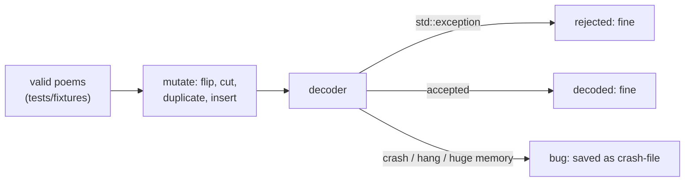

# Fuzzing

[Docs index](../README.md) · [Overview](overview.md) · [Benchmarks](benchmarks.md) · [Compression](compression.md) · [CRC32](crc32.md) · 🇷🇺 [Русская версия](../ru/fuzzing.md)

## In plain words

BardZip reads files made by other people, so it must stay calm when a file is broken or hostile. **Fuzzing** means feeding the program millions of random and slightly damaged inputs and watching for crashes, hangs and runaway memory use. The expected reaction to bad input is always the same: a clear error message and exit code 1 — never a crash.



## Two layers

| Layer | What | Where it runs |
|---|---|---|
| Mutation tests | a small deterministic fuzzer (fixed seed, ~60,000 mutations) inside the normal test suite | every `ctest` run and in CI |
| libFuzzer + AddressSanitizer | coverage-guided fuzzing: the engine learns which inputs reach new code | on demand, locally |

### Mutation tests ([tests/fuzz_tests.cpp](../../tests/fuzz_tests.cpp))

- damaged poems (bit flips, deleted/duplicated ranges, truncation, extra bytes and line breaks) must be rejected or decoded, never crash;
- random bytes (half of them with a real zstd frame start) must never break the zstd decompressor, and the output must always have exactly the declared size;
- damaged 36-byte headers must be rejected, or parsed and then survive a serialize/parse round trip.

### libFuzzer targets ([tools/fuzz/](../../tools/fuzz))

| Target | Covers |
|---|---|
| `fuzz_poem` | the whole poem reader: lines, stanzas, header, padding, lengths |
| `fuzz_header` | the 36-byte header parser (magic and CRC are repaired so the field checks run) |
| `fuzz_zstd` | the streaming zstd decompressor, fed in chunks of 1–256 bytes; output must never exceed the declared size |
| `fuzz_extract` | container extraction with a valid header, so payload handling and size/CRC checks really run |

Requires the MSVC AddressSanitizer and libFuzzer components of Visual Studio. In a **Developer PowerShell / x64 Native Tools prompt**:

```text
cmake -S . -B out/build/fuzz -G Ninja -DCMAKE_BUILD_TYPE=RelWithDebInfo ^
  "-DCMAKE_C_FLAGS=/fsanitize=address /fsanitize=fuzzer" ^
  "-DCMAKE_CXX_FLAGS=/EHsc /fsanitize=address /fsanitize=fuzzer" ^
  -DBARDZIP_STATIC_RUNTIME=OFF -DBARDZIP_BUILD_FUZZERS=ON -DBARDZIP_BUILD_TESTS=OFF
cmake --build out/build/fuzz --target fuzz_poem fuzz_header fuzz_zstd fuzz_extract
powershell -ExecutionPolicy Bypass -File scripts\fuzz.ps1 -BuildDir out\build\fuzz -Seconds 120
```

The instrumentation flags must be on **every** target (they are global compile flags) and the static runtime must be off, because AddressSanitizer needs the dynamic one. [scripts/fuzz.ps1](../../scripts/fuzz.ps1) runs each target for the given time, seeds `fuzz_poem` with the golden poems, prints executions per second and fails if anything crashed, timed out or exceeded 1 GiB of memory. Crash files are written to `<BuildDir>\artifacts`; copy a reproducer into the test suite as a regression test.

## Results so far

| Target | Run | Executions | Findings |
|---|---|---:|---|
| `fuzz_poem` | 90 s | 1,133,301 | none |
| `fuzz_header` | 90 s | 6,062,579 | none |
| `fuzz_zstd` | 90 s | 1,094,675 | none |
| `fuzz_extract` | 90 s | 718,420 | none |

Hardening done on the way: the zstd decoder now refuses windows above 2^24 bytes (16 MiB). BardZip's own encoder never uses more than 2 MiB, but a hostile frame could otherwise request up to 128 MiB of memory before producing a single byte. A test with a hand-made frame covers it.

Short runs find shallow bugs only. Before a larger release, run each target for 30–60 minutes.
