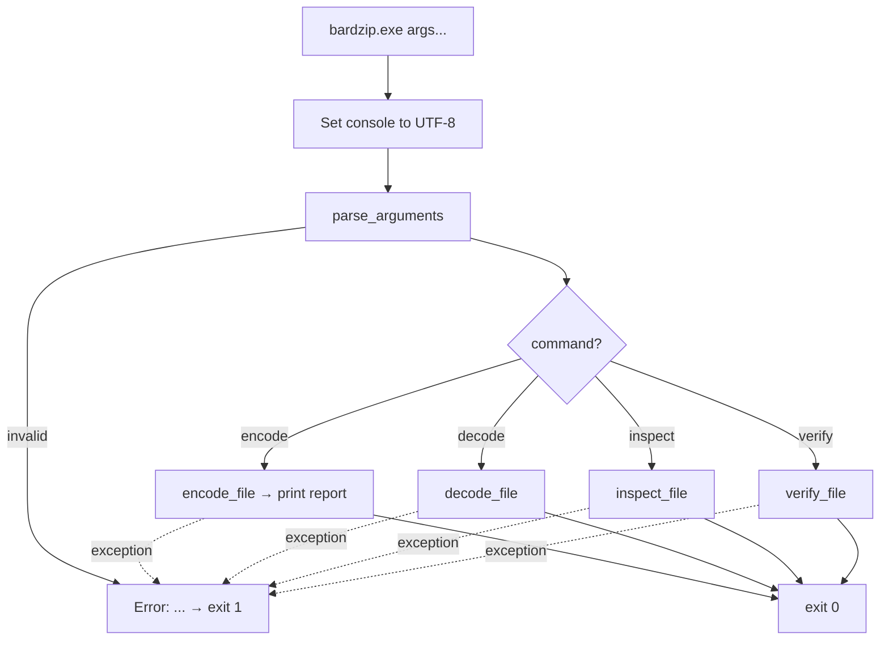
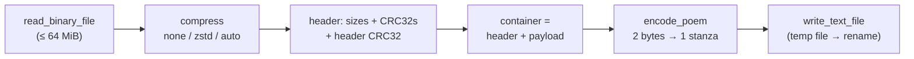
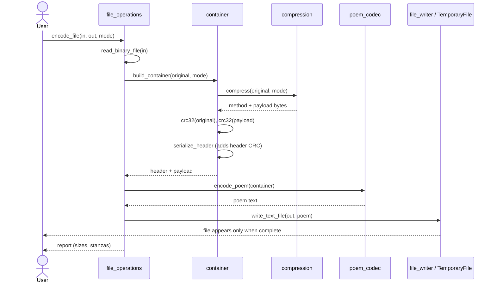
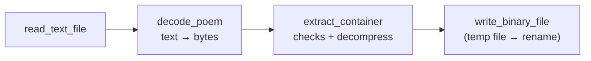
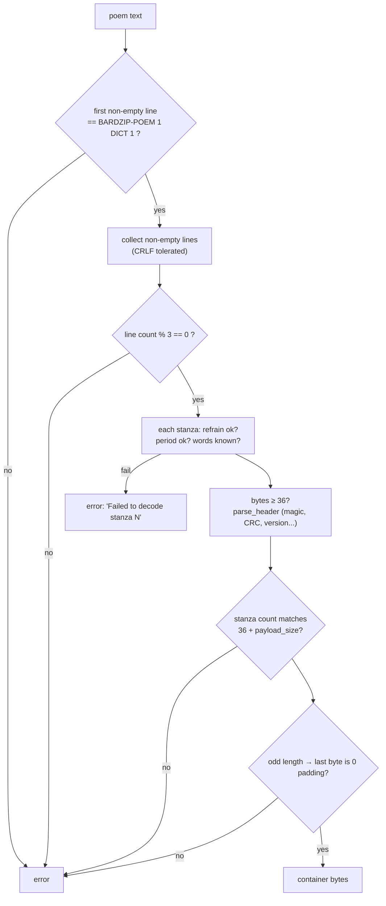
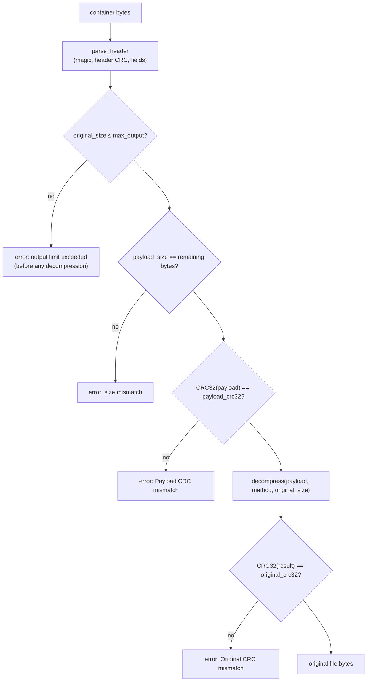
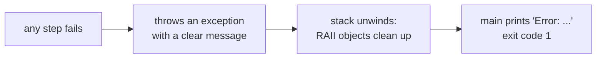

# Main flow

[Docs index](../README.md) · [Overview](overview.md) · [RAII](raii.md) · [CRC32](crc32.md) · [Compression](compression.md) · 🇷🇺 [Русская версия](../ru/main-flow.md)

All four commands live in [file_operations.cpp](../../src/core/file_operations.cpp). Each one is a short pipeline of steps; every step is a separate, testable function.

## 0. Program start

[main.cpp](../../src/main.cpp): on Windows it switches the console to UTF‑8 (so Russian text prints correctly), parses arguments, runs the chosen command, and turns any exception into `Error: <message>` with exit code `1`.

## 1. Encode: file → poem

Details:
- Odd container length → one `0x00` byte is appended for the last stanza.
- The report printed to stderr: method, original / payload / container / poem sizes, stanza count.

## 2. Decode: poem → file

### Inside `decode_poem`

### Inside `extract_container`

## 3. Verify

Same as decode, but the result is thrown away: `read_text_file → decode_poem → extract_container`, then prints `Verification successful.` Nothing is written to disk.

## 4. Inspect

`read_text_file → decode_poem → parse_header`, then prints version, compression, sizes, CRC32 values and the stanza count. It does **not** decompress or check the payload — the output ends with `Payload integrity: not checked`. Use `verify` for that.

## 5. Error handling in one picture

Because partial results are only published at the very end (see [RAII](raii.md)), a failure never leaves a half‑written output file.

## 6. Which command touches what?

| Command | Reads | Writes | Checks all CRCs | Decompresses |
|---|---|---|:---:|:---:|
| encode | any file | `.poem` | – (creates them) | – |
| decode | `.poem` | original file | ✅ | ✅ |
| verify | `.poem` | nothing | ✅ | ✅ (in memory) |
| inspect | `.poem` | nothing | header only | ❌ |
