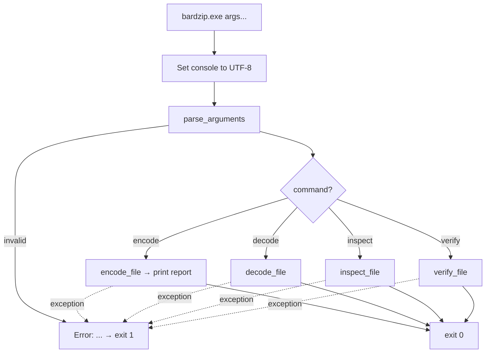
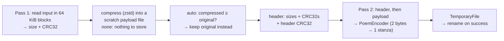
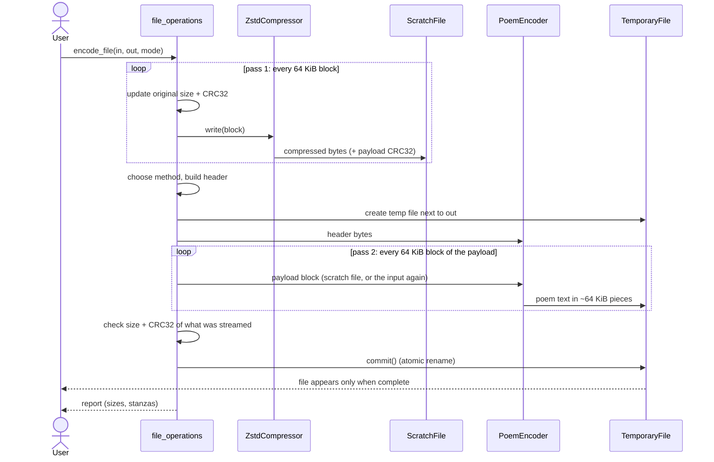
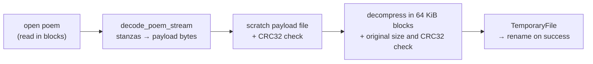
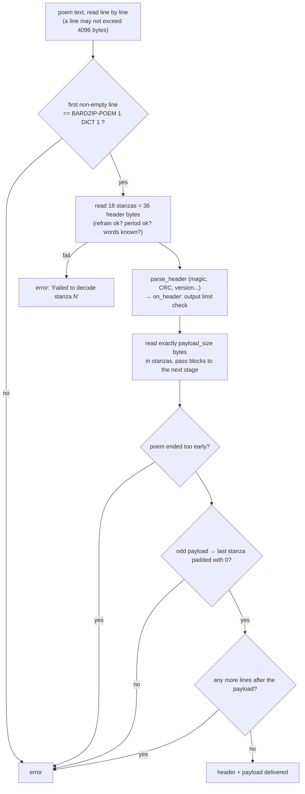
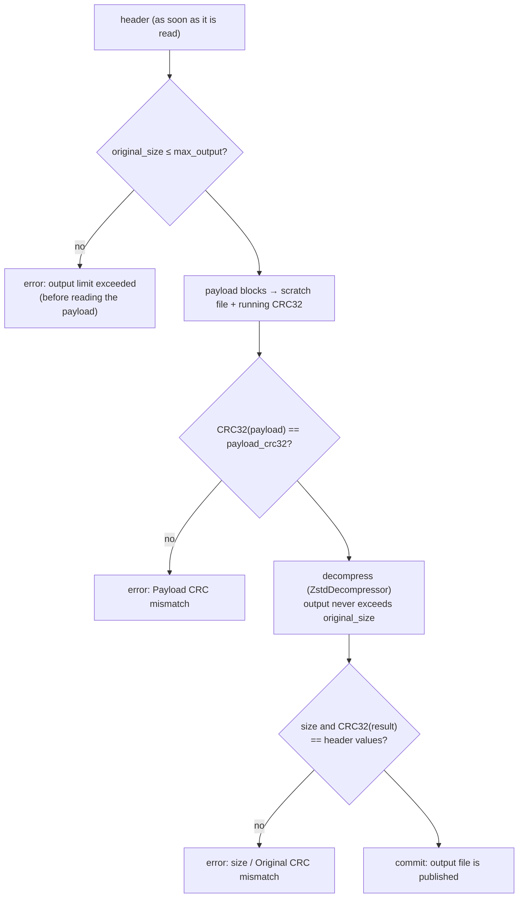
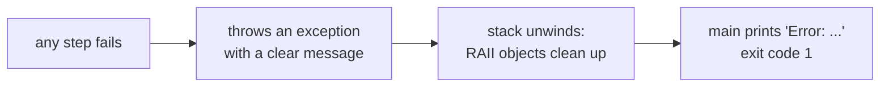

# Main flow

[Docs index](../../README.md) · [Overview](overview.md) · [RAII](raii.md) · [CRC32](crc32.md) · [Compression](compression.md) · [Streaming](streaming.md) · 🇷🇺 [Русская версия](../ru/main-flow.md)

All four commands live in [file_operations.cpp](../../src/core/file_operations.cpp). Each one is a short pipeline of steps; every step is a separate, testable function.

## 0. Program start

[main.cpp](../../src/main.cpp): on Windows it switches the console to UTF‑8 (so Russian text prints correctly), parses arguments, runs the chosen command, and turns any exception into `Error: <message>` with exit code `1`.

## 1. Encode: file → poem

Encoding makes **two passes** over the data in small 64 KiB blocks (see [Streaming](streaming.md)): the header sits at the start of the container, but its sizes and CRCs are only known after the whole file has been processed.

Details:
- Odd container length → one `0x00` byte is appended for the last stanza.
- If the data is stored (`none`, or `auto` decided compression does not help), pass 2 re-reads the input file instead of a scratch copy. While doing so it re-checks size and CRC32, so a file modified during encoding is detected ("Input file changed...") and nothing is published.
- The report printed to stderr: method, original / payload / container / poem sizes, stanza count.
- An already existing output file is rejected immediately, before any work is done.

## 2. Decode: poem → file

### Inside `decode_poem_stream`

### Inside the extraction stage

The decompressed bytes go straight into the temporary output file, which is published only after every check has passed.

## 3. Verify

Same as decode, but the decompressed bytes are only counted and checksummed, not written (the scratch payload file lives in the system temp folder and is deleted afterwards). Then it prints `Verification successful.`

## 4. Inspect

Reads the poem in a streaming way, validating its structure, and prints version, compression, sizes, CRC32 values and the stanza count taken from the header. It does **not** decompress or check the payload — the output ends with `Payload integrity: not checked`. Use `verify` for that.

## 5. Error handling in one picture

Because partial results are only published at the very end (see [RAII](raii.md)), a failure never leaves a half‑written output file.

## 6. Which command touches what?

| Command | Reads | Writes | Checks all CRCs | Decompresses |
|---|---|---|:---:|:---:|
| encode | any file | `.poem` | – (creates them) | – |
| decode | `.poem` | original file | ✅ | ✅ |
| verify | `.poem` | nothing | ✅ | ✅ (in memory) |
| inspect | `.poem` | nothing | header only | ❌ |
