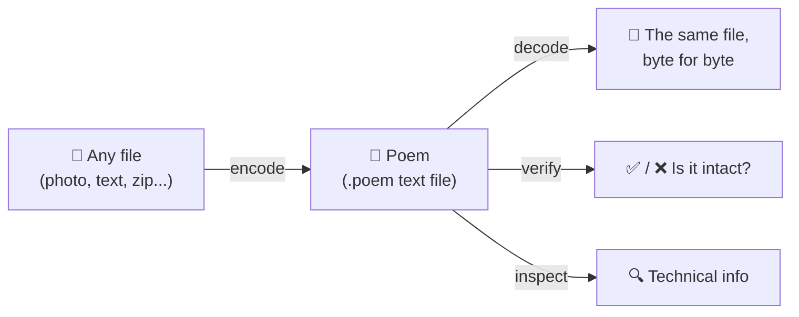
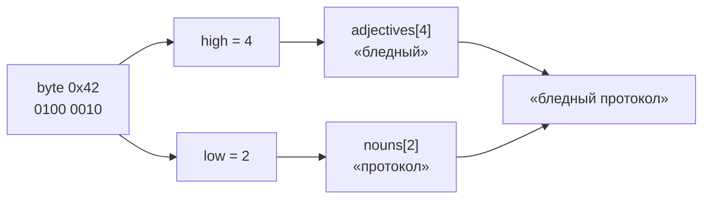
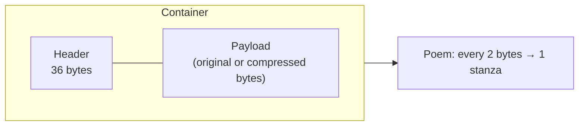
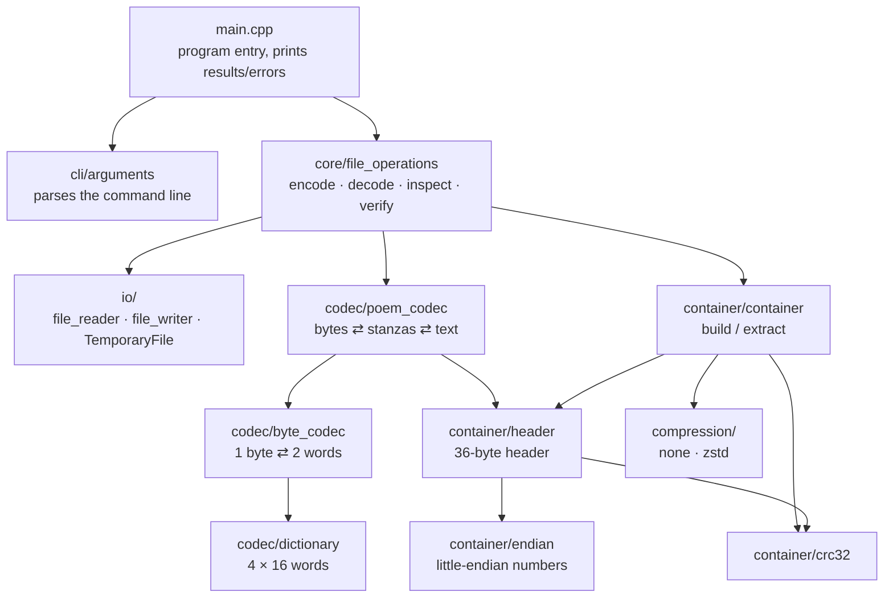

# BardZip — Overview

[Docs index](../README.md) · [Main flow](main-flow.md) · [RAII](raii.md) · [CRC32](crc32.md) · [Compression](compression.md) · 🇷🇺 [Русская версия](../ru/overview.md)

## 1. What is it? (no programming knowledge needed)

Every file on a computer — a photo, a document, a program — is just a long list of numbers from 0 to 255. Each such number is called a **byte**.

**BardZip** is a command-line tool that:

1. **Encodes** any file into a *poem* — a plain text file written in Russian where every pair of bytes becomes a three-line stanza.
2. **Decodes** the poem back into the **exact** original file.
3. **Verifies** that a poem is intact (nothing was damaged or edited).
4. **Inspects** a poem and prints technical information about the file hidden inside.

It is a toy/art project with serious engineering inside: checksums, optional compression, safe file writing and strict validation of corrupted input.



### A taste of the result

```text
BARDZIP-POEM 1 DICT 1

бледный протокол
оплакивает квитанцию.
четверг не наступил.

важный баклажан
подозревает пустоту.
четверг не наступил.
```

("pale protocol / mourns the receipt. / Thursday has not come." — the first stanza literally *spells* the letters `B` `Z` of the format signature.)

## 2. The core idea: words as digits

A byte is a number 0–255. Split it into two halves of 4 bits (called *nibbles*); each half is a number 0–15. We prepare **four dictionaries of 16 words** each, so every half becomes a word:

| Byte in a pair | High half (0–15) → word from | Low half (0–15) → word from |
|---|---|---|
| 1st byte → **line 1** | adjectives | nouns |
| 2nd byte → **line 2** | verbs | objects (line ends with `.`) |

Line 3 is always the same refrain: **«четверг не наступил.»** ("Thursday has not come.").

### Worked example

Byte `0x42` (the letter `B`) = binary `0100 0010` → high = 4, low = 2:



Byte `0x5A` (`Z`) → high 5, low 10 → `verbs[5]` = «оплакивает», `objects[10]` = «квитанцию» → «оплакивает квитанцию.»

So **one stanza = two bytes**. Decoding is unambiguous because each word exists in exactly one dictionary at exactly one position (a test checks that all words are unique).

> Cost: a poem is roughly **50× bigger** than the data it hides (≈108 bytes of UTF‑8 text per 2 data bytes). It is art, not an efficient format.

## 3. The container: what is actually hidden in the poem

Before turning bytes into words, BardZip wraps the data into a **container** called `BZP1`: a 36‑byte header plus the payload (the file itself, or its compressed form).



### Header layout (all numbers are little‑endian)

| Offset | Size | Field | Meaning |
|---:|---:|---|---|
| 0 | 4 | magic | `B Z P 1` — "this is a BardZip container" |
| 4 | 1 | version | currently `1` |
| 5 | 1 | compression | `0` = none, `1` = zstd |
| 6 | 2 | reserved | must be `0 0` |
| 8 | 8 | original size | size of the real file |
| 16 | 8 | payload size | size of the stored data |
| 24 | 4 | original CRC32 | checksum of the real file |
| 28 | 4 | payload CRC32 | checksum of the stored data |
| 32 | 4 | header CRC32 | checksum of bytes 0–31 |

*Little‑endian* means the least significant byte goes first: the number `0x12345678` is stored as `78 56 34 12` (see [endian.cpp](../../src/container/endian.cpp)).

If the container has an odd length, one `0x00` padding byte is added so the last stanza is full; the decoder knows the exact length from the header and checks the padding.

Why so many checksums? See [CRC32](crc32.md).

## 4. Architecture

The project is a small static library `bardzip_core`, a thin executable `bardzip` (CLI) and a test executable.



| Module | Files | Responsibility |
|---|---|---|
| CLI | [arguments](../../src/cli/arguments.cpp) | Understands `encode`, `decode`, `verify`, `inspect` and their options. |
| Core | [file_operations](../../src/core/file_operations.cpp) | Glues everything into the four user-visible operations. |
| Codec | [dictionary](../../src/codec/dictionary.cpp), [byte_codec](../../src/codec/byte_codec.cpp), [poem_codec](../../src/codec/poem_codec.cpp) | Translates bytes to words and back; builds and parses the poem text. |
| Container | [container](../../src/container/container.cpp), [header](../../src/container/header.cpp), [crc32](../../src/container/crc32.cpp), [endian](../../src/container/endian.cpp) | Builds/validates the `BZP1` container and its checksums. |
| Compression | [compression](../../src/compression/compression.cpp) | Optional zstd compression. |
| I/O | [file_reader](../../src/io/file_reader.cpp), [file_writer](../../src/io/file_writer.cpp), [temporary_file](../../src/io/temporary_file.cpp) | Safe reading and crash‑safe writing of files. |

Design principle: **each layer knows only the layer below it**, and pure logic (codec, container) is separated from the disk, so it is easy to test.

## 5. Using the tool

```text
bardzip encode <input> -o <output> [--compression none|zstd|auto]
bardzip decode <input> -o <output> [--max-output <bytes>]
bardzip verify <input> [--max-output <bytes>]
bardzip inspect <input>
```

| Command | What it does |
|---|---|
| `encode` | file → poem. `--compression` defaults to `auto` (see [Compression](compression.md)). Prints a short report (sizes, stanza count). |
| `decode` | poem → file. |
| `verify` | Fully decodes in memory and checks all checksums; prints `Verification successful.` Writes nothing. |
| `inspect` | Prints the header: version, compression, sizes, CRC32 values. Does **not** check the payload (it says so). |

```text
bardzip encode photo.jpg -o photo.poem
bardzip inspect photo.poem
bardzip verify  photo.poem
bardzip decode  photo.poem -o photo_restored.jpg
```

Exit code: `0` on success, `1` on any error (message goes to stderr as `Error: ...`).

### Safety rules

- **Never overwrites.** If the output file already exists, the command fails.
- **Atomic writes.** The result appears only when completely written ([RAII](raii.md)).
- **Size limits.** Files read from disk are limited to 64 MiB; decoded output is limited to `--max-output` (default 256 MiB) and is checked *before* decompression, which protects against "decompression bombs" (a tiny file that expands to gigabytes).
- **Strict decoding.** Any wrong word, missing period, wrong refrain, incomplete stanza, wrong padding, bad checksum or mismatched size is an error. Windows line endings (CRLF) and extra blank lines are tolerated.

> Good to know: a poem is ~50× larger than its data and poems are also read with the 64 MiB file limit, so the practical size of a *round trip* is about 1 MB of container data.

## 6. Building and testing

Requirements: CMake ≥ 3.25, a C++20 compiler (MSVC via the provided Visual Studio presets) and Windows (the safe writer uses the Windows API). The zstd library is found on the system or downloaded automatically by CMake.

```text
cmake --preset x64-debug
cmake --build out/build/x64-debug
ctest --test-dir out/build/x64-debug        # or run bardzip_tests.exe
```

Tests (folder [tests/](../../tests)) use a tiny custom test framework and cover: CRC32 reference values, endianness, every byte value and every stanza, header and container damage, compression edge cases, argument parsing, `TemporaryFile` behaviour and full file round trips.

## 7. Glossary

| Term | Plain meaning |
|---|---|
| Byte | A number 0–255; the basic unit of any file. |
| Nibble | Half a byte (4 bits), a number 0–15. |
| Container | Our own wrapper: header + data. |
| Header | The first 36 bytes describing the data. |
| Payload | The data after the header (original or compressed). |
| Checksum / CRC32 | A short "fingerprint" of data used to detect damage. |
| Compression | Making data smaller by removing redundancy. |
| Stanza | Three poem lines = 2 bytes. |
| RAII | A C++ technique that cleans up resources automatically. |
