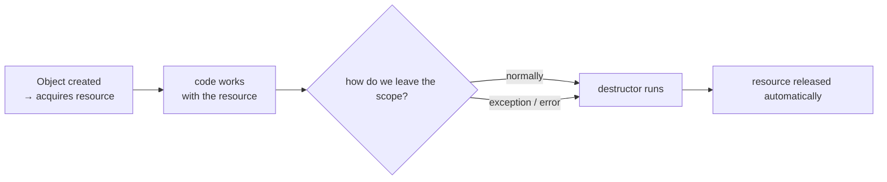
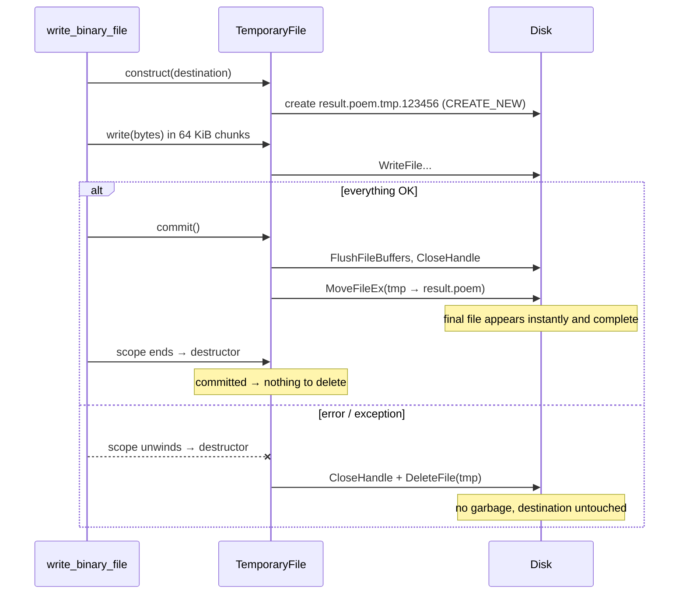
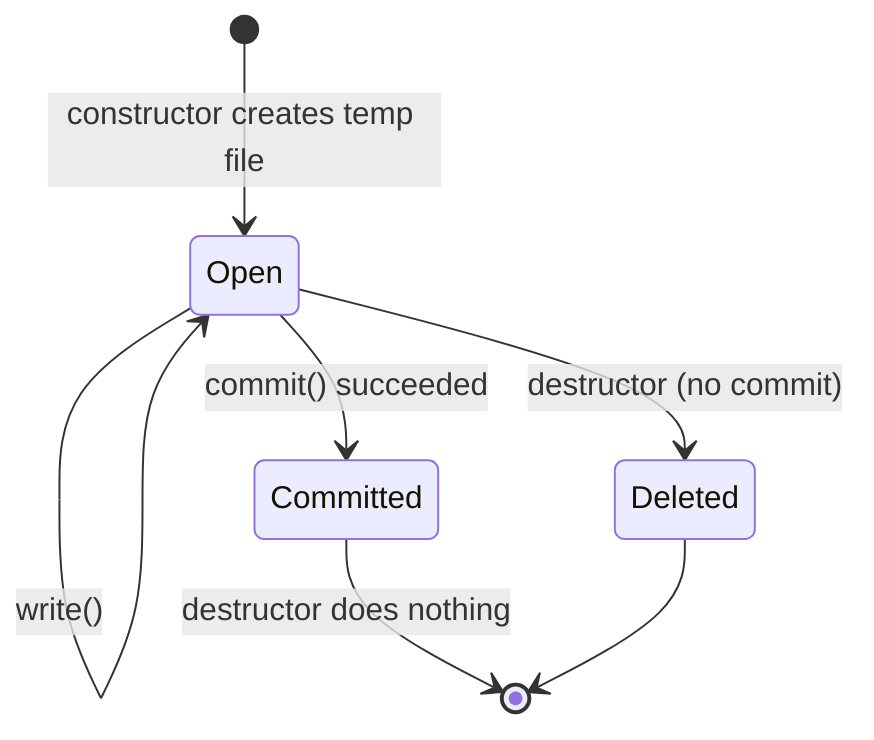
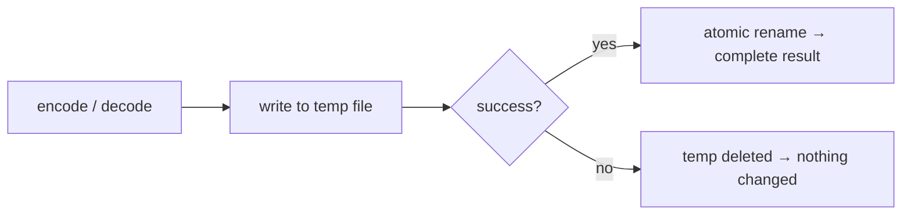

# RAII — automatic cleanup

[Docs index](../README.md) · [Overview](overview.md) · [Main flow](main-flow.md) · [CRC32](crc32.md) · [Compression](compression.md) · 🇷🇺 [Русская версия](../ru/raii.md)

## In plain words

Imagine renting a hotel room. A good hotel does not rely on you to remember to return the key: **when you leave, the room is released automatically**, even if you rushed out in a panic.

**RAII** (*Resource Acquisition Is Initialization*) is the same idea in C++: an object **takes a resource when it is created** (opens a file, allocates memory) and **gives it back automatically when it is destroyed** — when the code leaves its scope, whether normally or because of an error (exception). No "remember to close it" required, so nothing leaks.

## Where BardZip uses RAII

| Object | Resource | Released by |
|---|---|---|
| [`TemporaryFile`](../../include/io/temporary_file.hpp) | Windows file handle + a temporary file on disk | destructor closes the handle and deletes the temp file unless `commit()` succeeded |
| `std::unique_ptr<ZSTD_DCtx, DecompressionContextDeleter>` in [compression.cpp](../../src/compression/compression.cpp) | zstd decompression context (C library object) | custom deleter calls `ZSTD_freeDCtx` |
| `std::ifstream` in [file_reader.cpp](../../src/io/file_reader.cpp) | open input file | closes itself |
| `std::vector`, `std::string` everywhere | memory | free themselves |

The project has **no manual `new`/`delete`** and no "cleanup" blocks: every resource has an owner object.

## The star: `TemporaryFile`

### The problem

Writing the output directly to `result.poem` is risky: if the program crashes or an error occurs halfway, the user is left with a **broken half‑written file** — and may not notice.

### The solution

1. Create a temporary file next to the destination: `result.poem.tmp.<random number>` (exclusive creation: it must not already exist).
2. Write all data into it.
3. Only if everything succeeded call `commit()`: flush to disk, close, and **rename** the temp file to the final name in one step (`MoveFileExW` *without* the "replace existing" flag).
4. If anything fails before that, the destructor deletes the temp file.

### State machine

### Extra guarantees (all covered by [temporary_file_tests.cpp](../../tests/temporary_file_tests.cpp))

- **Copying is forbidden** (`= delete`): two objects must never own the same handle.
- **Never overwrites** an existing destination: `commit()` fails with "Output file already exists", and the temp file is cleaned up.
- Hidden until commit: the destination does not exist while writing.
- Concurrent writers get distinct temp names (random 64‑bit number, up to 100 attempts).
- Misuse (`write` after `commit`, double `commit`) throws `std::logic_error`.
- The destructor is `noexcept`: cleanup never throws while another error is already unwinding.
- Unicode and spaces in paths work (wide‑character Windows API).

## Why it matters for this project

The user either gets a **complete** file or **nothing** — never something in between.
