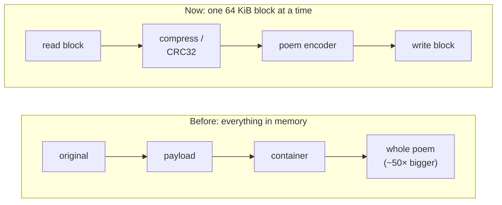
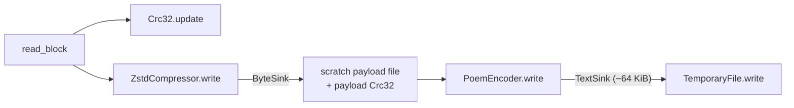
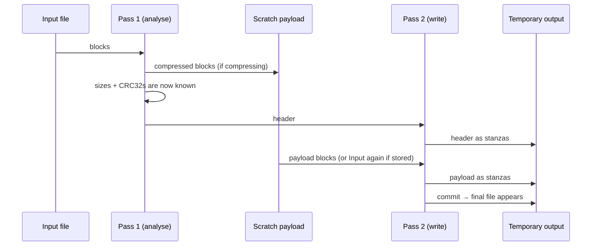
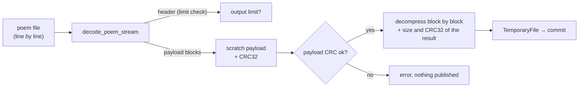

# Streaming — constant memory for any file size

[Docs index](../../README.md) · [Overview](overview.md) · [Main flow](main-flow.md) · [RAII](raii.md) · [CRC32](crc32.md) · [Compression](compression.md) · 🇷🇺 [Русская версия](../ru/streaming.md)

## In plain words

Imagine copying a huge book by hand. You do not need to read the whole book first: you read a page, write it down, turn the page. Your desk stays the same size whether the book has 10 pages or 10 000.

**Streaming** is exactly that. BardZip processes data in **64 KiB blocks** (about 30 pages of text) and never holds the whole file — or the whole poem — in memory.

### Why it was needed

A poem is ~50× bigger than the data. The earlier, in‑memory version kept at the same time the original file, the compressed payload, the container **and** the full poem text, so a 100 MB file could need many gigabytes of RAM — and was therefore capped at 64 MiB.

Measured on a 100 MB random file (stored mode): the poem is 5.4 GB, the peak memory of `bardzip encode` is about **12 MiB**.

## The building blocks

| Piece | What it does | Where |
|---|---|---|
| `read_block` | reads up to 64 KiB from a file | [file_reader](../../src/io/file_reader.cpp) |
| `Crc32` | incremental checksum: `update(block)` repeatedly, `value()` at the end | [crc32](../../src/container/crc32.cpp) |
| `ZstdCompressor` / `ZstdDecompressor` | push blocks in, get blocks out | [compression](../../src/compression/compression.cpp) |
| `PoemEncoder` | accepts bytes, keeps one pending byte between blocks, emits stanzas | [poem_codec](../../src/codec/poem_codec.cpp) |
| `decode_poem_stream` | reads the poem line by line, reports the header first, then payload blocks | [poem_codec](../../src/codec/poem_codec.cpp) |
| `ScratchFile` | uniquely named work file, always deleted ([RAII](raii.md)) | [temporary_file](../../src/io/temporary_file.cpp) |
| `TemporaryFile` | the output file that appears only when complete ([RAII](raii.md)) | [temporary_file](../../src/io/temporary_file.cpp) |

Stages are connected by a `ByteSink` — "a function that receives the next chunk of bytes" — so each stage knows nothing about the others.

## Why a scratch file? Header first, data later

The container starts with a header that contains the **payload size and both CRCs** — but those are only known after the whole file was processed. So encoding is two passes:

If the data is **stored** (no compression), no copy is made: pass 2 simply reads the input again and re‑checks size and CRC32. If the file changed in between, encoding fails with "Input file changed while it was being encoded" and nothing is published.

## Decoding: the reverse, with checks before trust

- The payload is verified by CRC32 **before** it is decompressed.
- Decompressed bytes go into the temporary output; it is published only after size and original CRC32 match.
- `verify` uses the same pipeline but discards the output bytes; `inspect` only reads the header (and validates the structure) without any scratch file.

## Limits and safety

| Rule | Value |
|---|---|
| Block size | 64 KiB |
| Input file size | ≤ `--max-input` (default 16 MiB, `0` = unlimited); memory does not grow either way |
| Poem line length | ≤ 4096 bytes — prevents a garbage file with one endless line from eating memory |
| Decoded output | ≤ `--max-output` (default 256 MiB), checked from the header before reading the payload and again while decompressing |
| Leftovers | scratch and temporary files are deleted on success **and** on any error |

Disk space needed while encoding: the poem itself (~50× the payload) plus, when compressing, a scratch payload file next to the output (never larger than the compressed data). Decoding needs a scratch payload file next to the output.

## What did not change

The file format is identical: poems from the previous in‑memory version decode with the streaming one and vice versa. The old in‑memory functions (`build_container`, `extract_container`, `encode_poem`, `decode_poem`) still exist for small data and tests; they share the same building blocks (`PoemEncoder`, `decode_poem_stream`, `ZstdCompressor`, `ZstdDecompressor`).
