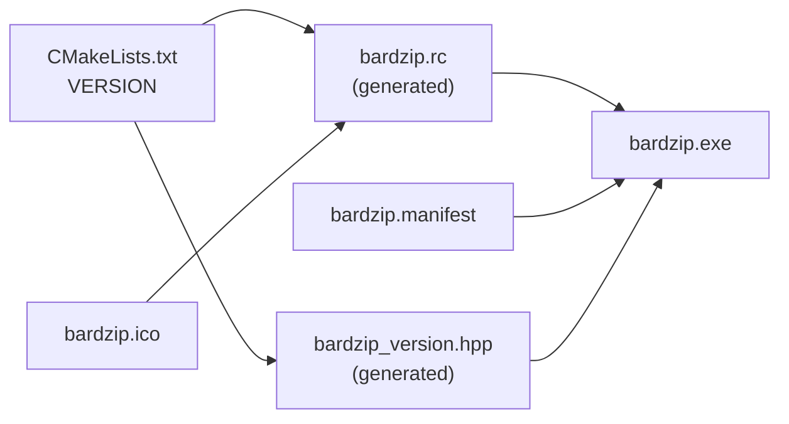

# Windows integration: icon, metadata, manifest, signing

[Docs index](../README.md) · [Overview](overview.md) · [Commands](commands.md) · 🇷🇺 [Русская версия](../ru/windows.md)

What makes `bardzip.exe` look and behave like a normal Windows program. Everything is embedded into the executable at build time (from [resources/](../../resources)); nothing extra has to be shipped.

## What is embedded

| Piece | Source | What it gives |
|---|---|---|
| **Icon** | [bardzip.ico](../../resources/bardzip.ico), made by [scripts/make-icon.ps1](../../scripts/make-icon.ps1) | the icon in Explorer, on the taskbar and in the console window title; sizes 16–256 px |
| **Version information** | [bardzip.rc.in](../../resources/bardzip.rc.in) | what *Properties → Details* shows: product name, description, version, copyright, original file name, project link |
| **Manifest** | [bardzip.manifest](../../resources/bardzip.manifest) | UTF-8 command line, long paths, no elevation prompt, supported Windows versions |

The version numbers come from `VERSION` in `CMakeLists.txt`, the same value as `bardzip --version` (one source of truth); the release script and CI check that they agree.



### The manifest, one line at a time

| Setting | Why |
|---|---|
| `activeCodePage = UTF-8` | **File names with Cyrillic (or any non-ASCII) letters work on the command line.** Without it the program could not open `фото.bin` (the console passes UTF-8, Windows expects the legacy code page). Needs Windows 10 1903+; on older systems non-ASCII names may still fail |
| `longPathAware` | paths longer than 260 characters, where the system policy allows it |
| `requestedExecutionLevel = asInvoker` | never asks for administrator rights |
| `supportedOS` (7, 8.1, 10, 11) | tells Windows the program is not a legacy one, so it applies no compatibility shims |

### Check it

```text
(Get-Item bardzip.exe).VersionInfo | Format-List *      # metadata
mt.exe -inputresource:bardzip.exe;#1 -out:manifest.xml    # the embedded manifest (VS prompt)
```

CI also encodes and decodes a file with a Cyrillic name and compares the version resource with `--version`.

## Changing the icon

Edit the drawing in [scripts/make-icon.ps1](../../scripts/make-icon.ps1) (it generates a multi-size `.ico` with System.Drawing and a preview `bardzip.png`), run it, rebuild. Or simply replace `resources/bardzip.ico` with your own file that contains at least 16, 32, 48 and 256 px images.

## Not done yet: code signing

The executable is **not digitally signed**, so Windows SmartScreen shows "Windows protected your PC" the first time someone runs the downloaded file (*More info → Run anyway*). Options, from cheapest:

| Option | Notes |
|---|---|
| Leave it unsigned | fine for friends; the release page publishes a SHA-256 so people can check the download, and the source is open |
| **SignPath Foundation** | free code signing for open-source projects; needs an application and a CI integration |
| **Azure Artifact Signing** (formerly Trusted Signing) | cheap monthly subscription; works from GitHub Actions |
| A purchased certificate | works, but ordinary OV certificates still need reputation to silence SmartScreen |
| A self-signed certificate | does **not** help other people: their Windows does not trust it |

Other ways to look "official": a `winget` manifest and a Scoop bucket (both install by name and verify the hash).
