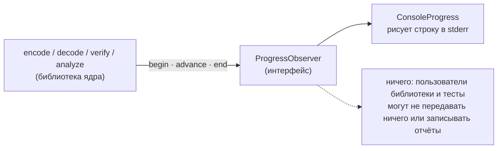

# Работа с bardzip в командной строке

[Оглавление](../README.md) · [Обзор](overview.md) · [Вспомогательные команды](commands.md) · [Интеграция с Windows](windows.md) · 🇬🇧 [English version](../en/cli.md)

Всё, что делает `bardzip` удобным в терминале и безопасным в скриптах: строка прогресса, `--quiet` / `--verbose`, коды выхода, конвейеры и автодополнение.

## Строка прогресса

Пока идёт долгая операция **и stderr — это консоль**, на экране перерисовывается одна строка:

```text
Writing poem  42%  1.2 GiB written  ~40 s left
```

| Операция | Какие этапы показываются |
|---|---|
| `encode` | `Reading` (вход, со сжатием) → `Writing poem` (долгая часть: поэма в ~54 раза больше данных) |
| `decode`, `verify` | `Reading poem` → `Restoring file` |
| `preview`, `estimate` | `Analyzing` |
| `-` как вход | `Receiving input` (копирование стандартного ввода во временный файл; общий объём неизвестен, поэтому показывается только количество) |

Правила:
- Показывается **только в консоли**. Если stderr перенаправлен в файл или конвейер, а также с `--quiet`, ничего не печатается, так что логи остаются чистыми.
- Идёт в **stderr**, никогда в stdout, поэтому не смешивается с результатом конвейера.
- Строка **стирается** при завершении этапа, а также перед сообщением об ошибке, поэтому не смешивается с другим выводом.
- Оставшееся время появляется, когда выполнен 1 % и этап идёт секунду; экран обновляется не чаще десяти раз в секунду, так что вывод не замедляет работу.



Ядро никогда ничего не печатает: оно лишь сообщает необязательному `ProgressObserver`. Тесты записывают отчёты и проверяют, что этапы идут в правильном порядке, позиция никогда не откатывается, заканчивается на общем объёме, а каждый этап закрывается, даже когда операция завершается ошибкой.

## `--quiet` и `--verbose`

Работают со всеми командами (`-q` / `-v`); вместе использовать их нельзя.

| | `--quiet` | обычный | `--verbose` |
|---|---|---|---|
| строка прогресса | нет | в консоли | в консоли |
| отчёт `encode` (stderr) | нет | да | да |
| `Verification successful.` | нет | да | да |
| тайминги и настройки | нет | нет | да: что куда кодируется, лимиты, время и МиБ/с |
| сообщения об ошибках | **да** | да | да, плюс `[exit code 4: bad data]` |
| запрошенные результаты (`preview`, `estimate`, `inspect`, `identify`) | **да** | да | да |

Коротко: `--quiet` оставляет только ошибки и сами результаты — удобно в скриптах, где о результате говорит код выхода.

## Коды выхода

| Код | Значение | Примеры |
|---:|---|---|
| 0 | успех | |
| 1 | внутренняя ошибка | баг, нехватка памяти |
| 2 | неверное использование | неизвестная опция, нет `-o`, `--quiet` вместе с `--verbose`, бинарные данные в терминал |
| 3 | проблема с файлом или системой | не открыть или не записать, выход существует (нужен `--force`), выход — это вход, диск полон |
| 4 | плохие данные | не поэма, повреждена, не совпала контрольная сумма или размер, неподдерживаемая версия |
| 5 | превышен лимит | `--max-input`, `--max-output` |

```text
bardzip verify photo.poem --quiet
switch ($LASTEXITCODE) {
    0 { "цела" }
    4 { "повреждена или это не поэма" }
    default { "не удалось проверить (код $LASTEXITCODE)" }
}
```

Внутри программы ошибки типизированы (`UsageError`, `LimitError` и стандартные типы исключений) и превращаются в код в одном месте — [exit_codes.cpp](../../src/cli/exit_codes.cpp); тесты проверяют, что реальные сбои дают документированные коды.

## Конвейеры: стандартный ввод и вывод

Используйте `-` там, где ожидается имя файла.

```text
type photo.zip | bardzip encode - -o - | bardzip decode - -o - > copy.zip
bardzip encode photo.zip -o - | bardzip verify -
bardzip encode - -o photo.poem < photo.zip
bardzip decode photo.poem -o - > restored.zip
```

| Где | Что значит `-` |
|---|---|
| вход `encode`, `preview`, `estimate` | читать стандартный ввод |
| вход `decode`, `verify`, `inspect`, `identify` | читать поэму из стандартного ввода |
| `-o -` у `encode` | писать поэму в стандартный вывод |
| `-o -` у `decode` | писать восстановленные байты в стандартный вывод |

Что важно знать:
- **Стандартный ввод сначала копируется во временный файл.** Кодировщику нужен точный размер, и он читает вход дважды (раз — измерить и сжать, раз — записать поэму). При получении копии учитывается `--max-input`, после работы она удаляется, в том числе при ошибках. Поэтому для `encode -` нужно место под копию.
- **Декодирование в терминал отклоняется** (код выхода 2): восстановленные данные бинарные. Перенаправьте их (`> файл` или `|` в другую программу) либо используйте `-o файл`.
- При `-o -` в stdout идёт только результат: отчёты и строка прогресса — в stderr. Потоки переключаются в бинарный режим, так что перевода строк нет, а Ctrl+Z не заканчивает ввод.
- `--quick` с `-` не работает (размер потока неизвестен).
- Файл, который действительно называется `-`, можно указать как `.\-`.


## Автодополнение в PowerShell

```text
bardzip completion powershell | Out-String | Invoke-Expression
```

Добавьте эту строку в профиль (`notepad $PROFILE`), чтобы она работала в каждой сессии. После этого <kbd>Tab</kbd> дополняет команды, опции и значения `--compression`; имена файлов дополняет сам PowerShell как обычно:

```text
bardzip en<Tab>                       →  encode
bardzip encode --c<Tab>               →  --compression
bardzip encode in -o out --compression z<Tab>   →  zstd
bardzip completion <Tab>              →  powershell
```

Скрипт **генерируется из той же таблицы команд и опций**, которую тест сверяет с настоящим разборщиком аргументов, поэтому автодополнение не может незаметно разойтись с программой.
