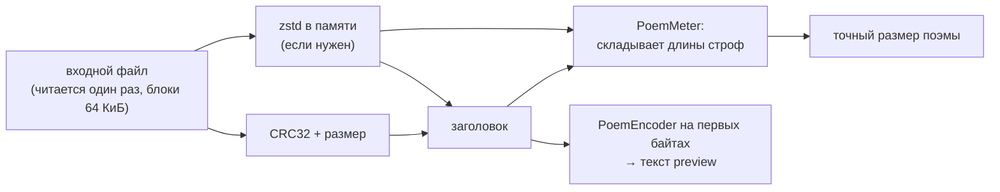
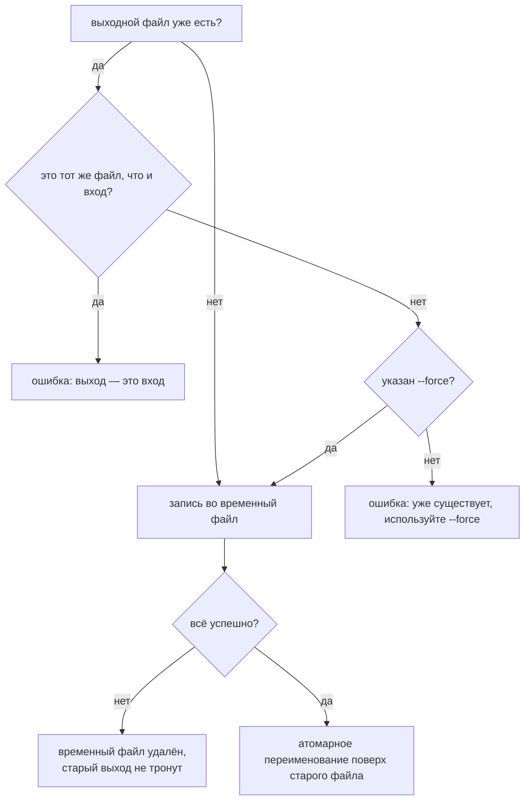

# Вспомогательные команды: preview, estimate, identify и --force

[Оглавление](../README.md) · [Обзор](overview.md) · [Основной поток](main-flow.md) · [Потоковая обработка](streaming.md) · [RAII](raii.md) · 🇬🇧 [English version](../en/commands.md)

Четыре небольших дополнения к `encode` / `decode`. Ни одно не меняет формат поэмы, а три новые команды никогда ничего не записывают.

## `preview` — «как будет выглядеть мой файл?»

Показывает первые строфы поэмы, которую записал бы `encode`, и **точный** общий размер — без создания (возможно, гигабайтного) файла.

```text
bardzip preview photo.png --stanzas 4
```

```text
BARDZIP-POEM 1 DICT 1

бледный протокол
оплакивает квитанцию.
четверг не наступил.
...
... 160 more stanzas ...
Poem size: 17,561 bytes (17.1 KiB) (exact), compression: zstd
```

Текст поэмы идёт в **stdout** (можно `> head.txt`), пояснения — в stderr. Первые 18 строф — заголовок контейнера (описывает файл: размеры, контрольные суммы), дальше строфы несут сами данные. `--stanzas <n>` принимает 1–10 000 (по умолчанию 6); `--compression` работает как в `encode`.

## `estimate` — «поместится ли на мой диск?»

```text
bardzip estimate photo.png
bardzip estimate photo.png --quick
bardzip estimate big.zip -o D:\out\big.poem
```

| Режим | Как | Результат |
|---|---|---|
| **точный** (по умолчанию) | читает файл один раз, при необходимости сжимает его в памяти и складывает длины всех строф | точный размер поэмы в байтах, пометка `EXACT` |
| **`--quick`** | смотрит только на размер файла | диапазон (`smallest … largest`) и типичное значение, пометка `APPROXIMATE`; предполагает отсутствие сжатия и случайные данные |

```text
Size:             2,016 bytes (2.0 KiB)
Compression:      none
Container:        2,052 bytes (2.0 KiB)
Stanzas:          1,026
Poem size:        109,361 bytes (106.8 KiB) - EXACT
Input limit:      within the limit of 16.0 MiB
Free disk space:  106.2 GiB on the volume of C:\...\BardZip
Result:           enough space
```

Почему диапазон: текст строфы зависит от данных (16 слов словаря имеют разную длину), поэтому по одному размеру файла можно назвать только границы и среднее. Точный режим считает настоящие слова.

Дополнительно сообщается: укладывается ли вход в `--max-input` (и что указать, если нет) и свободное место на диске выходного файла (`-o <путь>`, по умолчанию — текущая папка). При использовании zstd во внимание берётся и временная сжатая копия рядом с результатом. `estimate` не навязывает лимит входа — он о нём сообщает.



`preview` и `estimate` используют один и тот же анализ, который гарантированно совпадает с настоящим кодировщиком: тесты кодируют файлы во всех режимах и сравнивают размеры, число строф и первые строфы побайтово.

## `identify` — «что внутри?»

```text
bardzip identify riddle.poem
```

```text
Hidden file:      2,016 bytes (2.0 KiB), stored without compression
Looks like:       PNG image (.png)
First bytes:      89 50 4E 47 0D 0A 1A 0A 00 00 00 0D 49 48 44 52

This is a guess from the first bytes; the poem was not verified. ...
```

Читает только **начало** поэмы: первые 32 байта спрятанного файла (для zstd-нагрузки распаковывается ровно столько потока, сколько нужно) и сравнивает их с известными «магическими числами». Распознаются: PNG, JPEG, GIF, WebP, BMP, TIFF, ICO, PDF, ZIP (также `.docx`, `.xlsx`, `.jar`, `.apk`), 7z, RAR, gzip, bzip2, xz, zstd, SQLite, MP3, MP4/MOV, WAV, AVI, Ogg, FLAC, Matroska, старые документы Office, `.exe`/`.dll`, ELF, RTF, а также «обычный текст (UTF-8)» и «неизвестные двоичные данные».

Что важно знать:
- Это **догадка**: некоторые форматы имеют общую сигнатуру, а файл может начинаться как один формат и быть другим.
- Поэма **не проверяется** (повреждение после первых строф останется незамеченным). Для этого есть `verify`, затем `decode -o file.<расширение>`.
- Это отдельная команда намеренно: `decode` никогда не говорит, что внутри, так что поэма всё ещё может оставаться загадкой.

## `--force` — заменить существующий выходной файл

```text
bardzip encode photo.png -o photo.poem --force
```

Без `--force` `encode` и `decode` отказываются трогать существующий выходной файл. С ним старый файл заменяется **только после полной записи нового** (тот же механизм временного файла, см. [RAII](raii.md)): если что-то пошло не так на полпути, старый файл остаётся на месте нетронутым.



Выходным файлом **никогда не может быть сам входной**, даже с `--force` и при любой записи пути (`dir\..\dir\file`): вход ещё читается, пока пишется результат. Если файл назначения открыт в другой программе, Windows откажет в замене, и команда завершится ошибкой, оставив старый файл на месте.
