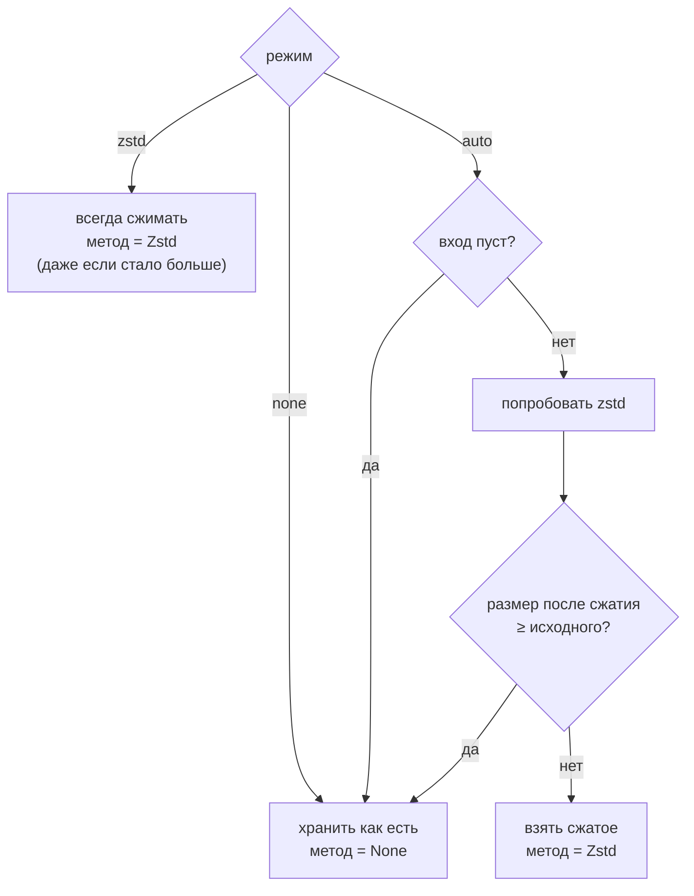
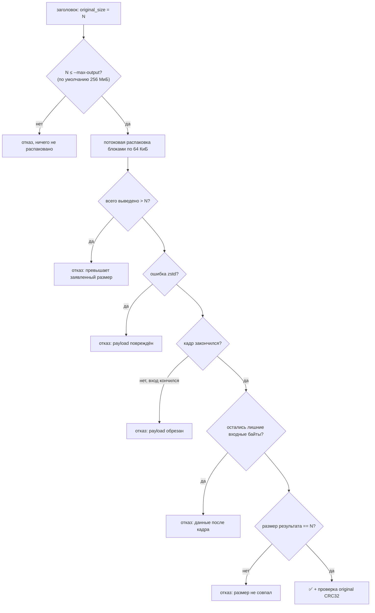
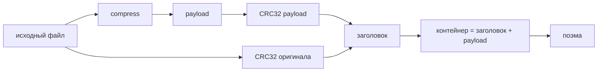

# Сжатие

[Оглавление](../README.md) · [Обзор](overview.md) · [Основной поток](main-flow.md) · [RAII](raii.md) · [CRC32](crc32.md) · 🇬🇧 [English version](../en/compression.md)

## Простыми словами

Сжатие делает данные **меньше**, используя повторы. Текст «ха ха ха ха ха ха» можно записать как «'ха ' × 6». Настоящие компрессоры делают это хитро для любых данных, а потом восстанавливают оригинал **точно** (сжатие без потерь).

Почему это важно здесь: поэма примерно **в 50 раз больше** данных, поэтому каждый байт, сэкономленный до кодирования, экономит ~50 байт поэмы.

BardZip использует **zstd** (Zstandard, Facebook/Meta) — быстрый современный компрессор — через официальную C‑библиотеку, уровень 3 (хороший баланс скорости и размера). Код: [compression.cpp](../../src/compression/compression.cpp).

## Режимы и методы

Это два разных понятия:

| | Значения | Где |
|---|---|---|
| **Режим (mode)** — что *просит пользователь* | `none`, `zstd`, `auto` (по умолчанию) | опция `--compression` |
| **Метод (method)** — что *реально применено* | `0 = None (хранится как есть)`, `1 = Zstd` | записывается в заголовок, байт 5 |

Поэтому `auto` **никогда не увеличивает payload**: несжимаемые данные (уже сжатые фото, zip, случайные байты) и крошечные входы хранятся как есть. Декодеру неважно, какой режим просили — он просто читает метод из заголовка.

## Сжатие

`ZSTD_compress` вызывается с буфером размера `ZSTD_compressBound` (худший случай, гарантированный библиотекой); затем буфер обрезается до реального размера. Любая ошибка библиотеки становится исключением.

## Распаковка — безопасно

Распаковка недоверенных данных опасна: злонамеренный крошечный файл может «обещать» развернуться в гигабайты (*бомба распаковки*). Защита BardZip:

- Контекст zstd хранится в `unique_ptr` с собственным deleter, поэтому всегда освобождается ([RAII](raii.md)).
- Для `None` размер payload должен точно равняться исходному.
- Валидатор заголовка дополнительно требует: для `None` — `original_size == payload_size` и равные CRC; для `Zstd` — payload не пуст.

Все случаи покрыты тестами [compression_tests.cpp](../../tests/compression_tests.cpp) и [container_tests.cpp](../../tests/container_tests.cpp).

## Место сжатия в конвейере

Обе суммы считаются при кодировании: одна по оригиналу (финальная проверка после распаковки), другая по payload (проверка до распаковки) — см. [CRC32](crc32.md).

## Практические советы

| Ваши данные | Рекомендуемый режим |
|---|---|
| Текст, исходный код, логи, документы | `auto` (выберет zstd) |
| JPG, PNG, ZIP, MP4 (уже сжаты) | `auto` (сохранит как есть) |
| Нужна предсказуемая минимальная обработка | `none` |
| Нужен zstd независимо от выгоды | `zstd` |
