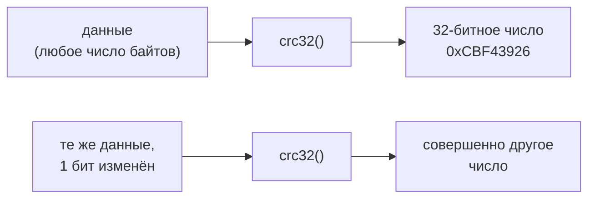
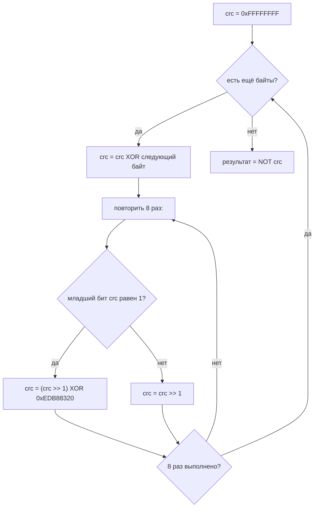
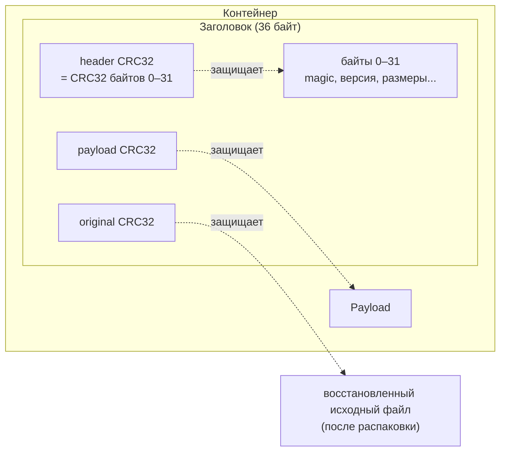
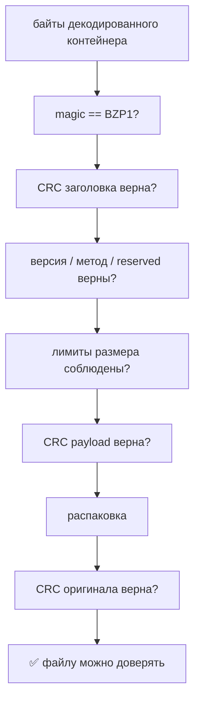

# CRC32 — «отпечаток пальца» данных

[Оглавление](../README.md) · [Обзор](overview.md) · [Основной поток](main-flow.md) · [RAII](raii.md) · [Сжатие](compression.md) · 🇬🇧 [English version](../en/crc32.md)

## Простыми словами

Отправляя посылку, на коробке пишут вес. Если при получении вес другой — что‑то добавили или убрали. **Контрольная сумма** — то же самое, но гораздо чувствительнее: короткое число (здесь 32 бита, записывается 8 шестнадцатеричными цифрами вроде `0xCBF43926`), вычисленное по **всем** байтам данных. Измените хоть один бит где угодно — число изменится (с огромной вероятностью).

**CRC32** (*Cyclic Redundancy Check, 32 бита* — циклический избыточный код) — известный способ получить такое число; его же используют ZIP, PNG, Ethernet и многие другие форматы.

> CRC32 находит **случайные** повреждения (опечатки, обрезание, ошибки диска/передачи). Это **не** защита от злоумышленника: любой может пересчитать подходящий CRC. BardZip этого и не обещает.

## Реализация

[crc32.cpp](../../src/container/crc32.cpp) — всего несколько строк, классический побитовый алгоритм, вариант **CRC‑32/ISO‑HDLC** (полином `0xEDB88320` в отражённой форме, начальное значение `0xFFFFFFFF`, итоговая инверсия):

Интуиция: данные рассматриваются как одно гигантское двоичное число, которое делится на особое 33‑битное число (полином); CRC — остаток от этого деления. Цикл выше выполняет деление по одному биту, используя только сдвиги и XOR.

Проверено на эталонных значениях в [crc32_tests.cpp](../../tests/crc32_tests.cpp):

| Вход | CRC32 |
|---|---|
| пусто | `0x00000000` |
| ASCII `123456789` | `0xCBF43926` (стандартное «контрольное значение») |

## Где BardZip это использует — три уровня защиты

В заголовке хранятся **три** контрольные суммы:

| Сумма | Считается по | Что ловит |
|---|---|---|
| Header CRC32 | первым 32 байтам заголовка | порчу/правку полей заголовка (размеры, метод...) *до* того, как мы им поверим |
| Payload CRC32 | payload в хранимом виде | повреждение хранимых/сжатых данных *до* распаковки |
| Original CRC32 | полностью восстановленному файлу | ошибки распаковки или неверный результат — финальная гарантия |

## Порядок проверок при декодировании

Сначала дешёвые проверки, а payload проверяется **до** распаковки: повреждённые данные отвергаются рано, и распаковщику по возможности не подсовывают мусор.

Кроме того, слой поэмы делает собственные структурные проверки (известные слова, припев, точки, число строк, заполнение), так что испорченная поэма часто ловится ещё до CRC.

## Связанное: числа little‑endian

CRC и размеры хранятся в заголовке как **little‑endian** целые ([endian.cpp](../../src/container/endian.cpp)): `0x12345678` → байты `78 56 34 12`. Фиксированный порядок байтов делает формат файла одинаковым на любом компьютере.
