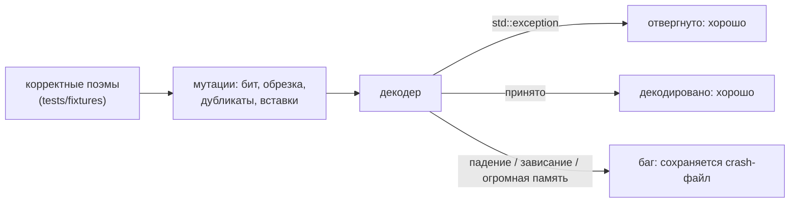

# Фаззинг

[Оглавление](../README.md) · [Обзор](overview.md) · [Бенчмарки](benchmarks.md) · [Сжатие](compression.md) · [CRC32](crc32.md) · 🇬🇧 [English version](../en/fuzzing.md)

## Простыми словами

BardZip читает файлы, сделанные другими людьми, поэтому он должен сохранять спокойствие, когда файл сломан или враждебен. **Фаззинг** — это подача программе миллионов случайных и слегка испорченных входов с наблюдением за падениями, зависаниями и неконтролируемым ростом памяти. Правильная реакция на плохой вход всегда одна: понятное сообщение об ошибке и код выхода 1 — никогда не падение.



## Два уровня

| Уровень | Что | Где запускается |
|---|---|---|
| Мутационные тесты | небольшой детерминированный фаззер (фиксированное зерно, ~60 000 мутаций) в обычном наборе тестов | при каждом `ctest` и в CI |
| libFuzzer + AddressSanitizer | фаззинг, управляемый покрытием: движок учится, какие входы доходят до нового кода | по запросу, локально |

### Мутационные тесты ([tests/fuzz_tests.cpp](../../tests/fuzz_tests.cpp))

- испорченные поэмы (перевороты битов, удалённые/дублированные участки, обрезка, лишние байты и переводы строк) должны отвергаться или декодироваться, но не приводить к падению;
- случайные байты (половина — с настоящим началом кадра zstd) не должны ломать распаковщик zstd, а результат всегда должен иметь ровно заявленный размер;
- испорченные 36-байтовые заголовки должны отвергаться либо разбираться и затем проходить цикл serialize/parse без изменений.

### Цели libFuzzer ([tools/fuzz/](../../tools/fuzz))

| Цель | Что покрывает |
|---|---|
| `fuzz_poem` | весь читатель поэмы: строки, строфы, заголовок, заполнение, длины |
| `fuzz_header` | разбор 36-байтового заголовка (magic и CRC исправляются, чтобы проверки полей реально выполнялись) |
| `fuzz_zstd` | потоковый распаковщик zstd, данные подаются кусками по 1–256 байт; результат никогда не превышает заявленный размер |
| `fuzz_extract` | извлечение контейнера с корректным заголовком, чтобы обработка payload и проверки размера/CRC реально выполнялись |

Нужны компоненты MSVC AddressSanitizer и libFuzzer из Visual Studio. В **Developer PowerShell / x64 Native Tools**:

```text
cmake -S . -B out/build/fuzz -G Ninja -DCMAKE_BUILD_TYPE=RelWithDebInfo ^
  "-DCMAKE_C_FLAGS=/fsanitize=address /fsanitize=fuzzer" ^
  "-DCMAKE_CXX_FLAGS=/EHsc /fsanitize=address /fsanitize=fuzzer" ^
  -DBARDZIP_STATIC_RUNTIME=OFF -DBARDZIP_BUILD_FUZZERS=ON -DBARDZIP_BUILD_TESTS=OFF
cmake --build out/build/fuzz --target fuzz_poem fuzz_header fuzz_zstd fuzz_extract
powershell -ExecutionPolicy Bypass -File scripts\fuzz.ps1 -BuildDir out\build\fuzz -Seconds 120
```

Флаги инструментации должны быть у **каждой** цели (это глобальные флаги компиляции), а статическая среда выполнения должна быть выключена, потому что AddressSanitizer требует динамическую. [scripts/fuzz.ps1](../../scripts/fuzz.ps1) запускает каждую цель на заданное время, засевает `fuzz_poem` эталонными поэмами, печатает число запусков в секунду и завершается с ошибкой, если что-то упало, зависло или превысило 1 ГиБ памяти. Файлы с падениями пишутся в `<BuildDir>\artifacts`; воспроизводящий пример стоит добавить в набор тестов как регрессионный.

## Результаты на сегодня

| Цель | Запуск | Запусков | Находки |
|---|---|---:|---|
| `fuzz_poem` | 90 с | 1 133 301 | нет |
| `fuzz_header` | 90 с | 6 062 579 | нет |
| `fuzz_zstd` | 90 с | 1 094 675 | нет |
| `fuzz_extract` | 90 с | 718 420 | нет |

Укрепление, сделанное попутно: распаковщик zstd теперь отказывается от окон больше 2^24 байт (16 МиБ). Собственный кодировщик BardZip использует не больше 2 МиБ, но враждебный кадр мог бы потребовать до 128 МиБ памяти ещё до того, как выдаст хоть один байт. Это покрыто тестом с кадром, собранным вручную.

Короткие запуски находят только поверхностные ошибки. Перед крупным релизом запускайте каждую цель на 30–60 минут.
