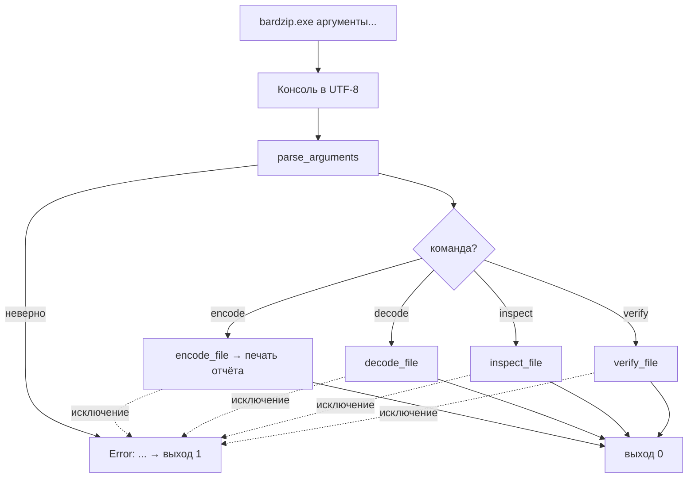
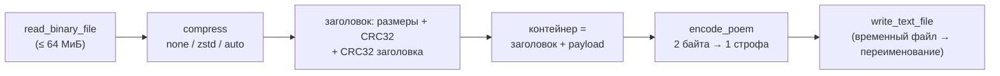
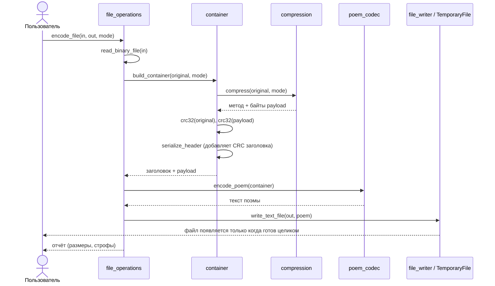
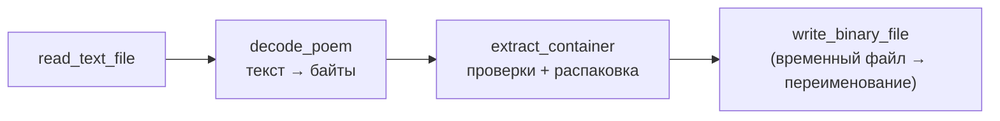
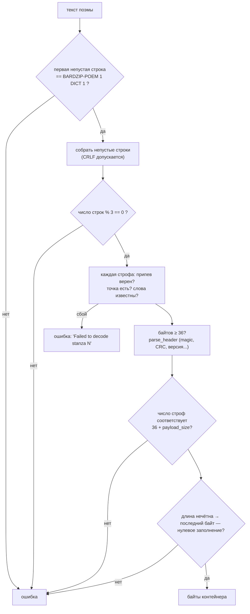
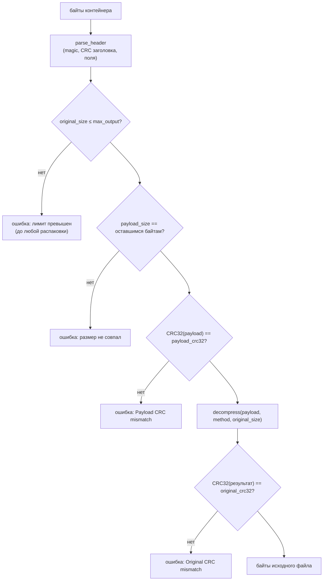
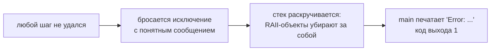

# Основной поток работы

[Оглавление](../README.md) · [Обзор](overview.md) · [RAII](raii.md) · [CRC32](crc32.md) · [Сжатие](compression.md) · 🇬🇧 [English version](../en/main-flow.md)

Все четыре команды находятся в [file_operations.cpp](../../src/core/file_operations.cpp). Каждая — короткий конвейер шагов; каждый шаг — отдельная, тестируемая функция.

## 0. Запуск программы

[main.cpp](../../src/main.cpp): в Windows переключает консоль на UTF‑8 (чтобы русский текст выводился верно), разбирает аргументы, выполняет выбранную команду, а любое исключение превращает в `Error: <сообщение>` и код выхода `1`.

## 1. Encode: файл → поэма

Детали:
- Нечётная длина контейнера → для последней строфы добавляется один байт `0x00`.
- Отчёт в stderr: метод, размеры (исходный / payload / контейнер / поэма), число строф.

## 2. Decode: поэма → файл

### Внутри `decode_poem`

### Внутри `extract_container`

## 3. Verify

То же, что decode, но результат выбрасывается: `read_text_file → decode_poem → extract_container`, затем печатается `Verification successful.` На диск ничего не пишется.

## 4. Inspect

`read_text_file → decode_poem → parse_header`, затем печать версии, сжатия, размеров, CRC32 и числа строф. Распаковки и проверки payload **нет** — вывод заканчивается строкой `Payload integrity: not checked`. Для проверки используйте `verify`.

## 5. Обработка ошибок одной картинкой

Поскольку результат публикуется только в самом конце (см. [RAII](raii.md)), сбой никогда не оставляет наполовину записанный файл.

## 6. Кто что трогает

| Команда | Читает | Пишет | Проверяет все CRC | Распаковывает |
|---|---|---|:---:|:---:|
| encode | любой файл | `.poem` | – (создаёт их) | – |
| decode | `.poem` | исходный файл | ✅ | ✅ |
| verify | `.poem` | ничего | ✅ | ✅ (в памяти) |
| inspect | `.poem` | ничего | только заголовок | ❌ |
