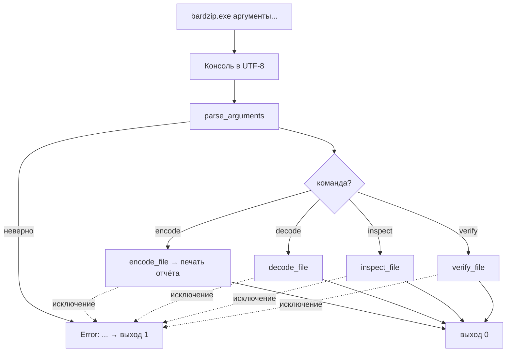
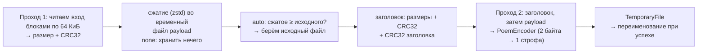
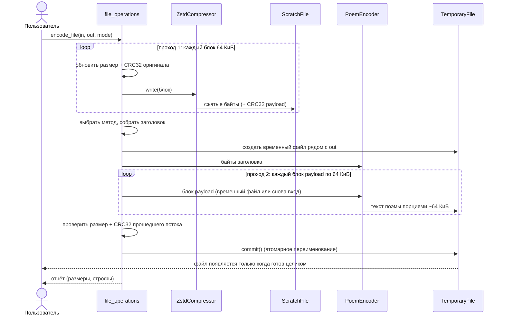
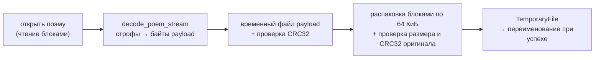
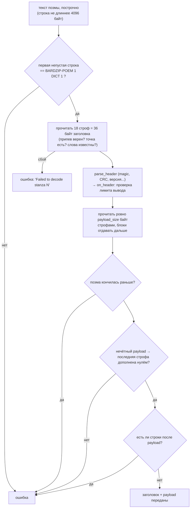
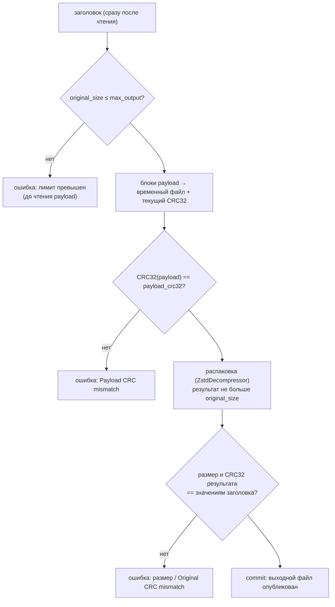
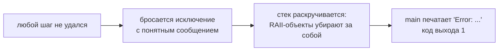

# Основной поток работы

[Оглавление](../README.md) · [Обзор](overview.md) · [RAII](raii.md) · [CRC32](crc32.md) · [Сжатие](compression.md) · [Потоковая обработка](streaming.md) · 🇬🇧 [English version](../en/main-flow.md)

Все четыре команды находятся в [file_operations.cpp](../../src/core/file_operations.cpp). Каждая — короткий конвейер шагов; каждый шаг — отдельная, тестируемая функция.

## 0. Запуск программы

[main.cpp](../../src/main.cpp): в Windows переключает консоль на UTF‑8 (чтобы русский текст выводился верно), разбирает аргументы, выполняет выбранную команду, а любое исключение превращает в `Error: <сообщение>` и код выхода `1`.

## 1. Encode: файл → поэма

Кодирование делает **два прохода** по данным небольшими блоками по 64 КиБ (см. [Потоковая обработка](streaming.md)): заголовок стоит в начале контейнера, но его размеры и CRC известны только после обработки всего файла.

Детали:
- Нечётная длина контейнера → для последней строфы добавляется один байт `0x00`.
- Если данные хранятся как есть (`none` или `auto` решил, что сжатие не помогает), на проходе 2 заново читается входной файл, а не временная копия. При этом снова проверяются размер и CRC32, поэтому файл, изменённый во время кодирования, обнаруживается («Input file changed...»), и ничего не публикуется.
- Отчёт в stderr: метод, размеры (исходный / payload / контейнер / поэма), число строф.
- Уже существующий выходной файл отвергается сразу, до начала работы.

## 2. Decode: поэма → файл

### Внутри `decode_poem_stream`

### Внутри этапа извлечения

Распакованные байты сразу пишутся во временный выходной файл, который публикуется только после прохождения всех проверок.

## 3. Verify

То же, что decode, но распакованные байты только подсчитываются и сверяются по контрольной сумме, а не записываются (временный файл payload лежит во временной папке системы и затем удаляется). После этого печатается `Verification successful.`

## 4. Inspect

Читает поэму потоково, проверяя её структуру, и печатает версию, сжатие, размеры, CRC32 и число строф (вычисленное по заголовку). Распаковки и проверки payload **нет** — вывод заканчивается строкой `Payload integrity: not checked`. Для проверки используйте `verify`.

## 5. Обработка ошибок одной картинкой

Поскольку результат публикуется только в самом конце (см. [RAII](raii.md)), сбой никогда не оставляет наполовину записанный файл.

## 6. Кто что трогает

| Команда | Читает | Пишет | Проверяет все CRC | Распаковывает |
|---|---|---|:---:|:---:|
| encode | любой файл | `.poem` | – (создаёт их) | – |
| decode | `.poem` | исходный файл | ✅ | ✅ |
| verify | `.poem` | ничего | ✅ | ✅ (в памяти) |
| inspect | `.poem` | ничего | только заголовок | ❌ |
