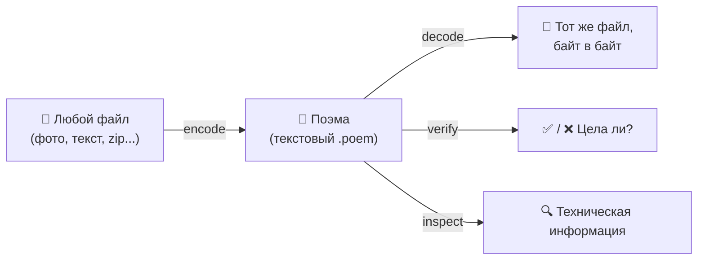
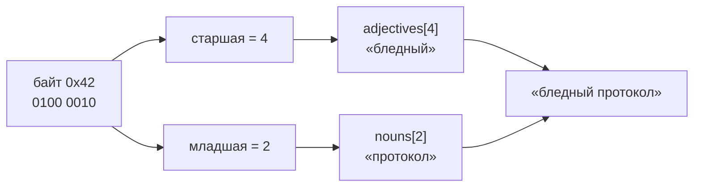
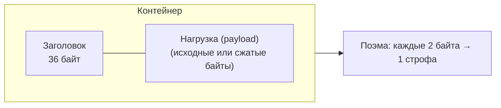
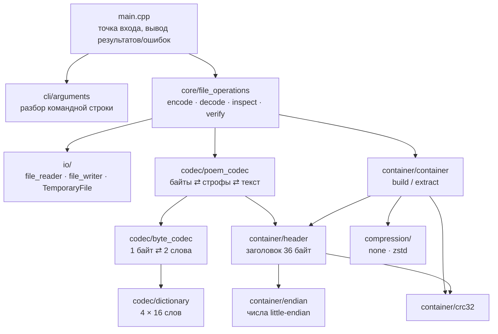

# BardZip — обзор проекта

[Оглавление](../README.md) · [Основной поток](main-flow.md) · [RAII](raii.md) · [CRC32](crc32.md) · [Сжатие](compression.md) · [Потоковая обработка](streaming.md) · 🇬🇧 [English version](../en/overview.md)

## 1. Что это? (знание программирования не требуется)

Любой файл на компьютере — фото, документ, программа — это просто длинный список чисел от 0 до 255. Каждое такое число называется **байтом**.

**BardZip** — консольная утилита, которая:

1. **Кодирует** (`encode`) любой файл в *поэму* — обычный текстовый файл на русском, где каждая пара байтов превращается в строфу из трёх строк.
2. **Декодирует** (`decode`) поэму обратно в **точную** копию исходного файла.
3. **Проверяет** (`verify`), что поэма цела (ничего не испорчено и не отредактировано).
4. **Показывает информацию** (`inspect`) о файле, спрятанном в поэме.

Это игрушечный/художественный проект, но с серьёзной инженерией внутри: контрольные суммы, опциональное сжатие, безопасная запись файлов и строгая проверка повреждённых данных.



### Как выглядит результат

```text
BARDZIP-POEM 1 DICT 1

бледный протокол
оплакивает квитанцию.
четверг не наступил.

важный баклажан
подозревает пустоту.
четверг не наступил.
```

Первая строфа буквально «записывает» буквы `B` и `Z` — начало сигнатуры формата.

## 2. Главная идея: слова как цифры

Байт — число 0–255. Разделим его на две половины по 4 бита (*полубайты*, «нибблы»); каждая половина — число от 0 до 15. Заводим **четыре словаря по 16 слов**, и каждая половина становится словом:

| Байт в паре | Старшая половина (0–15) → слово из | Младшая половина (0–15) → слово из |
|---|---|---|
| 1-й байт → **строка 1** | прилагательные | существительные |
| 2-й байт → **строка 2** | глаголы | дополнения (строка заканчивается `.`) |

Строка 3 всегда одинаковая — припев: **«четверг не наступил.»**

### Пример

Байт `0x42` (буква `B`) = двоичное `0100 0010` → старшая = 4, младшая = 2:



Байт `0x5A` (`Z`) → старшая 5, младшая 10 → `verbs[5]` = «оплакивает», `objects[10]` = «квитанцию» → «оплакивает квитанцию.»

Итак, **одна строфа = два байта**. Декодирование однозначно: каждое слово встречается ровно в одном словаре на одной позиции (тест проверяет уникальность слов).

> Цена: поэма примерно **в 50 раз больше** спрятанных данных (≈108 байт UTF‑8 текста на 2 байта данных). Это искусство, а не эффективный формат.

## 3. Контейнер: что на самом деле спрятано в поэме

Перед превращением байтов в слова BardZip упаковывает данные в **контейнер** `BZP1`: заголовок 36 байт + полезная нагрузка (сам файл или его сжатая версия).



### Структура заголовка (все числа little‑endian)

| Смещение | Размер | Поле | Смысл |
|---:|---:|---|---|
| 0 | 4 | magic | `B Z P 1` — «это контейнер BardZip» |
| 4 | 1 | version | сейчас `1` |
| 5 | 1 | compression | `0` = без сжатия, `1` = zstd |
| 6 | 2 | reserved | обязаны быть `0 0` |
| 8 | 8 | original size | размер настоящего файла |
| 16 | 8 | payload size | размер хранимых данных |
| 24 | 4 | original CRC32 | контрольная сумма настоящего файла |
| 28 | 4 | payload CRC32 | контрольная сумма хранимых данных |
| 32 | 4 | header CRC32 | контрольная сумма байтов 0–31 |

*Little‑endian* — младший байт идёт первым: число `0x12345678` хранится как `78 56 34 12` (см. [endian.cpp](../../src/container/endian.cpp)).

Если длина контейнера нечётная, добавляется один нулевой байт, чтобы последняя строфа была полной; декодер знает точную длину из заголовка и проверяет заполнение.

Зачем столько контрольных сумм? См. [CRC32](crc32.md).

## 4. Архитектура

Проект — маленькая статическая библиотека `bardzip_core`, тонкое приложение `bardzip` (CLI) и исполняемый файл с тестами.



| Модуль | Файлы | Ответственность |
|---|---|---|
| CLI | [arguments](../../src/cli/arguments.cpp) | Понимает `encode`, `decode`, `verify`, `inspect` и их опции. |
| Core | [file_operations](../../src/core/file_operations.cpp) | Склеивает всё в четыре пользовательские операции. |
| Codec | [dictionary](../../src/codec/dictionary.cpp), [byte_codec](../../src/codec/byte_codec.cpp), [poem_codec](../../src/codec/poem_codec.cpp) | Байты ↔ слова; сборка и разбор текста поэмы. |
| Container | [container](../../src/container/container.cpp), [header](../../src/container/header.cpp), [crc32](../../src/container/crc32.cpp), [endian](../../src/container/endian.cpp) | Сборка/проверка контейнера `BZP1` и контрольных сумм. |
| Compression | [compression](../../src/compression/compression.cpp) | Опциональное сжатие zstd. |
| I/O | [file_reader](../../src/io/file_reader.cpp), [file_writer](../../src/io/file_writer.cpp), [temporary_file](../../src/io/temporary_file.cpp) | Безопасное чтение и «безаварийная» запись файлов. |

Принцип: **каждый слой знает только о слое ниже**, а чистая логика (codec, container) отделена от диска — её легко тестировать.

## 5. Как пользоваться

```text
bardzip encode <input> -o <output> [--compression none|zstd|auto] [--max-input <bytes>] [--force]
bardzip decode <input> -o <output> [--max-output <bytes>] [--force]
bardzip verify <input> [--max-output <bytes>]
bardzip inspect <input>
bardzip preview <input> [--stanzas <n>] [--compression none|zstd|auto]
bardzip estimate <input> [--compression none|zstd|auto] [--quick] [--max-input <bytes>] [-o <output>]
bardzip identify <poem>
bardzip completion powershell
bardzip --help | --version
```

| Команда | Что делает |
|---|---|
| `encode` | файл → поэма. `--compression` по умолчанию `auto` (см. [Сжатие](compression.md)). Печатает короткий отчёт (размеры, число строф). |
| `decode` | поэма → файл. |
| `verify` | Полностью декодирует в памяти и проверяет все суммы; печатает `Verification successful.` Ничего не пишет на диск. |
| `inspect` | Печатает заголовок: версия, сжатие, размеры, CRC32. Нагрузку **не** проверяет (так и пишет). |
| `preview` | Показывает первые строфы поэмы, которую записал бы `encode`, и её точный размер. Ничего не пишет. |
| `estimate` | Сообщает, насколько велика будет поэма и поместится ли она на диск (точно или диапазон с `--quick`). Ничего не пишет. |
| `identify` | Определяет по первым байтам тип файла, спрятанного в поэме (PNG, JPEG, ZIP...). |
| `completion` | Печатает скрипт автодополнения для PowerShell. |

Эти вспомогательные команды и `--force` описаны в разделе [Вспомогательные команды](commands.md). Каждая команда также принимает `-q`/`--quiet` и `-v`/`--verbose`; `-` означает стандартный ввод/вывод; в консоли программа показывает строку прогресса и возвращает документированные коды выхода — см. [Командная строка](cli.md).

```text
bardzip encode photo.jpg -o photo.poem
bardzip inspect photo.poem
bardzip verify  photo.poem
bardzip decode  photo.poem -o photo_restored.jpg
```

Код возврата: `0` — успех, `1` — любая ошибка (сообщение в stderr в виде `Error: ...`).

### Правила безопасности

- **По умолчанию не перезаписывает.** Если выходной файл уже есть — команда завершается ошибкой; `--force` заменяет его, но только когда новый результат готов целиком, а выходным файлом никогда не может быть сам входной.
- **Атомарная запись.** Результат появляется только когда записан целиком ([RAII](raii.md)).
- **Лимиты размера.** Расход памяти не зависит от размера файла (см. [Потоковая обработка](streaming.md)), но поэма в ~54 раза больше данных, поэтому `encode` по умолчанию отказывается принимать вход больше **16 МиБ** (поэма около 0,8 ГБ). В сообщении об ошибке указан ожидаемый размер поэмы; лимит повышается опцией `--max-input <bytes>` (`--max-input 0` — без лимита). Результат декодирования ограничен `--max-output` (по умолчанию 256 МиБ) и проверяется *до* распаковки — защита от «бомб распаковки» (крошечный файл, разворачивающийся в гигабайты). Одна строка поэмы не может быть длиннее 4096 байт.
- **Строгий разбор.** Неверное слово, отсутствие точки, неверный припев, неполная строфа, неверное заполнение, плохая контрольная сумма или несовпадение размеров — ошибка. Окончания строк Windows (CRLF), лишние пустые строки и метка порядка байтов UTF-8 в начале файла (её добавляют некоторые редакторы при пересохранении поэмы) допускаются.

> Полезно знать: поэма в ~50 раз больше данных (файл 100 МБ превращается в поэму ~5,4 ГБ), поэтому следите за свободным местом на диске. Память при этом остаётся в районе 10–15 МиБ.

## 6. Сборка и тесты

Нужно: CMake ≥ 3.25, компилятор C++20 (MSVC через готовые пресеты Visual Studio) и Windows (безопасная запись использует Windows API). Библиотека zstd ищется в системе или скачивается CMake автоматически.

```text
cmake --preset x64-debug
cmake --build out/build/x64-debug
ctest --test-dir out/build/x64-debug        # или запустить bardzip_tests.exe
```

Тесты ([tests/](../../tests)) используют минимальный собственный фреймворк и покрывают: эталонные значения CRC32, порядок байтов, все значения байта и все строфы, повреждения заголовка и контейнера, крайние случаи сжатия, разбор аргументов, поведение `TemporaryFile` и полные циклы файлов.

## 7. Словарик

| Термин | Простыми словами |
|---|---|
| Байт | Число 0–255; базовая единица любого файла. |
| Полубайт (nibble) | Половина байта (4 бита), число 0–15. |
| Контейнер | Наша «обёртка»: заголовок + данные. |
| Заголовок | Первые 36 байт, описывающие данные. |
| Payload (нагрузка) | Данные после заголовка (исходные или сжатые). |
| Контрольная сумма / CRC32 | Короткий «отпечаток» данных для обнаружения повреждений. |
| Сжатие | Уменьшение данных за счёт устранения повторов. |
| Строфа | Три строки поэмы = 2 байта. |
| RAII | Приём C++: ресурсы освобождаются автоматически. |
