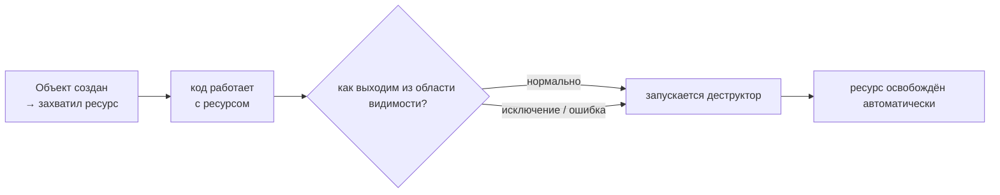
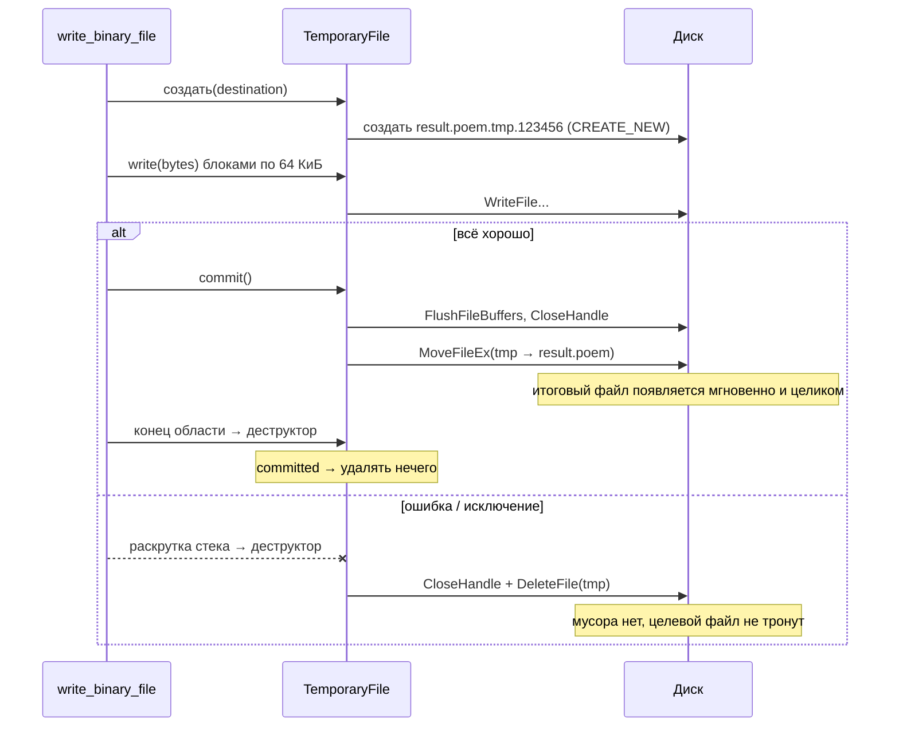
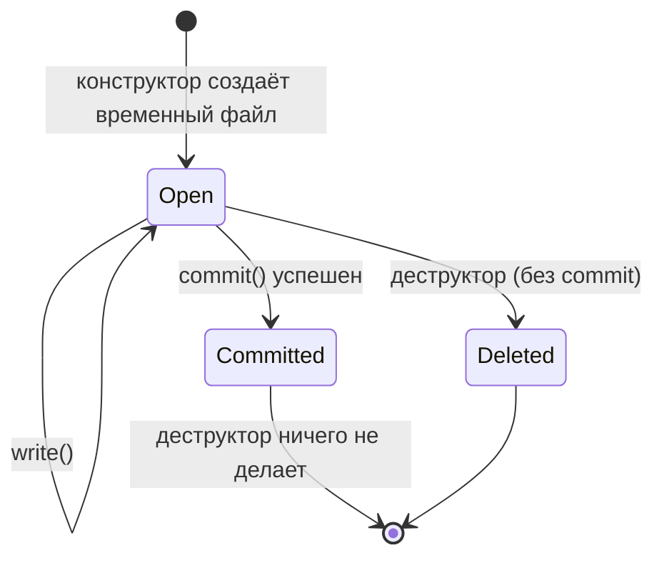
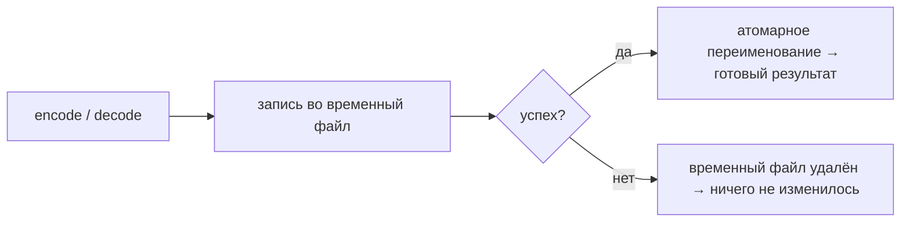

# RAII — автоматическая уборка

[Оглавление](../../README.md) · [Обзор](overview.md) · [Основной поток](main-flow.md) · [CRC32](crc32.md) · [Сжатие](compression.md) · [Потоковая обработка](streaming.md) · 🇬🇧 [English version](../en/raii.md)

## Простыми словами

Представьте аренду номера в отеле. Хороший отель не надеется, что вы вспомните вернуть ключ: **когда вы выезжаете, номер освобождается автоматически**, даже если вы выбежали в панике.

**RAII** (*Resource Acquisition Is Initialization* — «получение ресурса есть инициализация») — та же идея в C++: объект **захватывает ресурс при создании** (открывает файл, выделяет память) и **автоматически возвращает его при уничтожении** — когда код покидает область видимости, нормально или из‑за ошибки (исключения). Не нужно «не забыть закрыть» — поэтому ничего не утекает.

## Где BardZip использует RAII

| Объект | Ресурс | Кто освобождает |
|---|---|---|
| [`TemporaryFile`](../../include/io/temporary_file.hpp) | Дескриптор файла Windows + временный файл на диске | деструктор закрывает дескриптор и удаляет временный файл, если `commit()` не прошёл |
| [`ScratchFile`](../../include/io/temporary_file.hpp) | рабочий файл (например, сжатый payload при [потоковой обработке](streaming.md)) | деструктор удаляет его всегда |
| `std::unique_ptr<ZSTD_DCtx, ...>` / `std::unique_ptr<ZSTD_CCtx, ...>` внутри `ZstdDecompressor` / `ZstdCompressor` ([compression.cpp](../../src/compression/compression.cpp)) | контексты zstd (объекты C‑библиотеки) | собственные deleter'ы вызывают `ZSTD_freeDCtx` / `ZSTD_freeCCtx` |
| `std::ifstream` / `std::ofstream` | открытые файлы | закрываются сами |
| `std::vector`, `std::string` повсюду | память | освобождают себя сами |

В проекте **нет ручных `new`/`delete`** и блоков «очистки»: у каждого ресурса есть объект‑владелец.

## Главный герой: `TemporaryFile`

### Проблема

Писать результат сразу в `result.poem` рискованно: если программа упадёт или случится ошибка на полпути, у пользователя останется **сломанный недописанный файл**, и он может этого не заметить.

### Решение

1. Создать временный файл рядом с целевым: `result.poem.tmp.<случайное число>` (эксклюзивное создание: такого файла быть не должно).
2. Записать в него все данные.
3. Только если всё прошло успешно, вызвать `commit()`: сбросить на диск, закрыть и **переименовать** временный файл в итоговое имя одним действием (`MoveFileExW` *без* флага «заменить существующий»).
4. Если что‑то пошло не так раньше, деструктор удалит временный файл.

### Автомат состояний

### Дополнительные гарантии (всё покрыто [temporary_file_tests.cpp](../../tests/temporary_file_tests.cpp))

- **Копирование запрещено** (`= delete`): два объекта не должны владеть одним дескриптором.
- **Никогда не перезаписывает** существующий файл: `commit()` падает с «Output file already exists», временный файл убирается.
- До `commit` итогового файла не видно.
- Параллельные писатели получают разные временные имена (случайное 64‑битное число, до 100 попыток).
- Неправильное использование (`write` после `commit`, двойной `commit`) бросает `std::logic_error`.
- Деструктор `noexcept`: уборка не бросает исключений, когда уже идёт обработка другой ошибки.
- Юникод и пробелы в путях работают (широкие символы Windows API).

## Почему это важно для проекта

Пользователь получает либо **целый** файл, либо **ничего** — и никогда «что‑то среднее».
