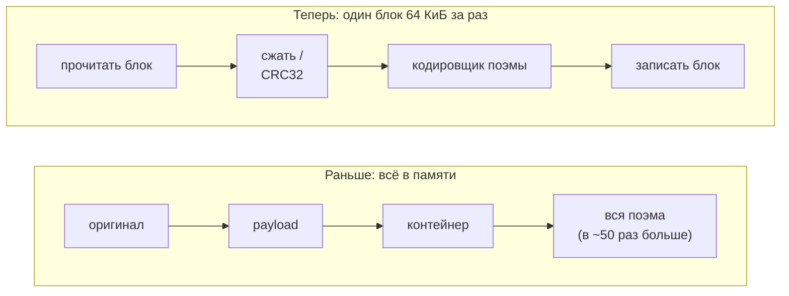
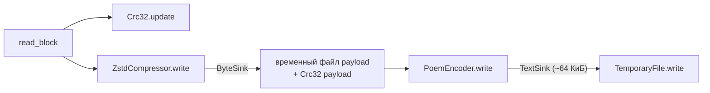
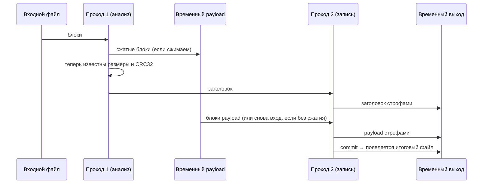
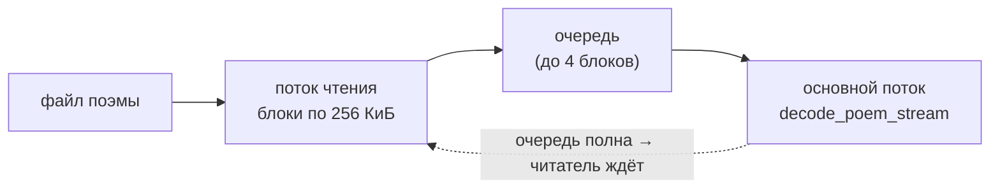
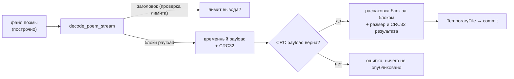

# Потоковая обработка — постоянная память для файла любого размера

[Оглавление](../README.md) · [Обзор](overview.md) · [Основной поток](main-flow.md) · [RAII](raii.md) · [CRC32](crc32.md) · [Сжатие](compression.md) · 🇬🇧 [English version](../en/streaming.md)

## Простыми словами

Представьте, что вы переписываете от руки огромную книгу. Читать её целиком заранее не нужно: прочитали страницу, записали, перевернули. Ваш стол остаётся одного размера, будь в книге 10 страниц или 10 000.

**Потоковая обработка** — это именно так. BardZip обрабатывает данные **блоками по 64 КиБ** (примерно 30 страниц текста) и никогда не держит в памяти весь файл или всю поэму.

### Зачем это понадобилось

Поэма примерно в 50 раз больше данных. Прежняя версия «всё в памяти» держала одновременно исходный файл, сжатый payload, контейнер **и** полный текст поэмы, так что файлу в 100 МБ могли понадобиться гигабайты ОЗУ — поэтому размер был ограничен 64 МиБ.

Замер на случайном файле 100 МБ (режим без сжатия): поэма 5,4 ГБ, пик памяти `bardzip encode` — около **12 МиБ**.

## Кирпичики

| Элемент | Что делает | Где |
|---|---|---|
| `read_block` | читает до 64 КиБ из файла | [file_reader](../../src/io/file_reader.cpp) |
| `Crc32` | инкрементальная сумма: много раз `update(блок)`, в конце `value()` | [crc32](../../src/container/crc32.cpp) |
| `ZstdCompressor` / `ZstdDecompressor` | на вход блоки, на выходе блоки | [compression](../../src/compression/compression.cpp) |
| `PoemEncoder` | принимает байты, между блоками помнит один отложенный байт, выдаёт строфы | [poem_codec](../../src/codec/poem_codec.cpp) |
| `decode_poem_stream` | читает поэму построчно, сначала сообщает заголовок, затем блоки payload | [poem_codec](../../src/codec/poem_codec.cpp) |
| `ScratchFile` | рабочий файл с уникальным именем, всегда удаляется ([RAII](raii.md)) | [temporary_file](../../src/io/temporary_file.cpp) |
| `TemporaryFile` | выходной файл, который появляется только когда готов ([RAII](raii.md)) | [temporary_file](../../src/io/temporary_file.cpp) |

Этапы соединены через `ByteSink` — «функцию, принимающую очередной кусок байтов», — поэтому каждый этап ничего не знает об остальных.

## Зачем временный файл? Заголовок первым, данные потом

Контейнер начинается с заголовка, где записаны **размер payload и обе CRC** — но они известны только после обработки всего файла. Поэтому кодирование идёт в два прохода:

Если данные **хранятся как есть** (без сжатия), копия не делается: проход 2 просто заново читает вход и снова проверяет размер и CRC32. Если файл за это время изменился, кодирование завершается ошибкой «Input file changed while it was being encoded», и ничего не публикуется.

## Поток опережающего чтения (decode, verify, inspect)

Раньше чтение файла поэмы с диска и декодирование шли одно за другим. `PrefetchStreambuf` ([prefetch_stream.cpp](../../src/io/prefetch_stream.cpp)) читает файл в **фоновом потоке** в небольшую очередь (блоки по 256 КиБ, не более 4 в очереди), пока основной поток декодирует предыдущие блоки. Память остаётся ограниченной (пик около 7 МиБ вместо 5), а `verify`/`decode` стали примерно в 1,5 раза быстрее ([бенчмарки](benchmarks.md)).

Правила реализации: ошибка в потоке чтения сохраняется и перебрасывается в основном потоке после данных, прочитанных до неё; если декодирование останавливается раньше (ошибка либо `inspect` после заголовка), деструктор останавливает поток и ждёт его, поэтому ничего не продолжает работать и не держит файл открытым; `encode` этим не пользуется.

## Декодирование: наоборот, с проверкой до доверия

- Payload проверяется по CRC32 **до** распаковки.
- Распакованные байты пишутся во временный выходной файл; он публикуется только после совпадения размера и CRC32 оригинала.
- `verify` использует тот же конвейер, но выбрасывает выходные байты; `inspect` читает только заголовок (проверяя структуру) и вообще не создаёт временных файлов.

## Лимиты и безопасность

| Правило | Значение |
|---|---|
| Размер блока | 64 КиБ |
| Размер входного файла | ≤ `--max-input` (по умолчанию 16 МиБ, `0` — без лимита); память в любом случае не растёт |
| Длина строки поэмы | ≤ 4096 байт — мусорный файл с одной бесконечной строкой не съест память |
| Декодированный результат | ≤ `--max-output` (по умолчанию 256 МиБ), проверяется по заголовку до чтения payload и ещё раз во время распаковки |
| Остатки | временные файлы удаляются при успехе **и** при любой ошибке |

Место на диске при кодировании: сама поэма (~50× payload) плюс, при сжатии, временный файл payload рядом с результатом (не больше сжатых данных). Для декодирования нужен временный файл payload рядом с результатом.

## Что не изменилось

Формат файла тот же: поэмы прежней версии «в памяти» декодируются потоковой версией и наоборот. Старые функции (`build_container`, `extract_container`, `encode_poem`, `decode_poem`) остались для небольших данных и тестов; они используют те же кирпичики (`PoemEncoder`, `decode_poem_stream`, `ZstdCompressor`, `ZstdDecompressor`).
