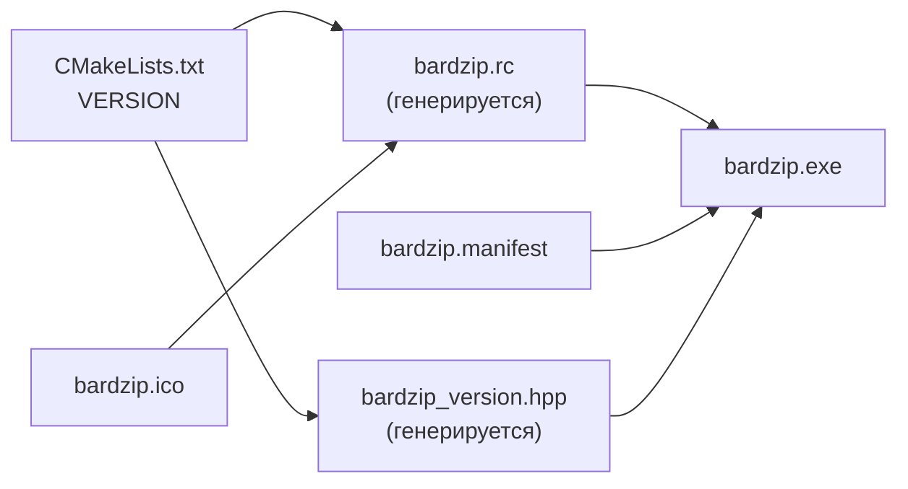

# Интеграция с Windows: иконка, метаданные, манифест, подпись

[Оглавление](../README.md) · [Обзор](overview.md) · [Команды](commands.md) · 🇬🇧 [English version](../en/windows.md)

Что делает `bardzip.exe` похожим на обычную программу Windows и определяет его поведение. Всё встраивается в исполняемый файл при сборке (из папки [resources/](../../resources)); ничего дополнительно поставлять не нужно.

## Что встроено

| Что | Источник | Что даёт |
|---|---|---|
| **Иконка** | [bardzip.ico](../../resources/bardzip.ico), создаётся [scripts/make-icon.ps1](../../scripts/make-icon.ps1) | значок в проводнике, на панели задач и в заголовке окна консоли; размеры 16–256 px |
| **Сведения о версии** | [bardzip.rc.in](../../resources/bardzip.rc.in) | то, что показывает *Свойства → Подробно*: название продукта, описание, версия, авторские права, исходное имя файла, ссылка на проект |
| **Манифест** | [bardzip.manifest](../../resources/bardzip.manifest) | командная строка в UTF-8, длинные пути, без запроса повышения прав, поддерживаемые версии Windows |

Номера версий берутся из `VERSION` в `CMakeLists.txt` — это то же значение, что печатает `bardzip --version` (единый источник); скрипт релиза и CI проверяют, что они совпадают.



### Манифест по пунктам

| Настройка | Зачем |
|---|---|
| `activeCodePage = UTF-8` | **Имена файлов с кириллицей (и любыми не-ASCII буквами) работают в командной строке.** Без неё программа не могла открыть `фото.bin` (консоль передаёт UTF-8, а Windows ждёт устаревшую кодовую страницу). Нужна Windows 10 1903+; в более старых системах не-ASCII имена могут по-прежнему не работать |
| `longPathAware` | пути длиннее 260 символов там, где это разрешает политика системы |
| `requestedExecutionLevel = asInvoker` | никогда не просит права администратора |
| `supportedOS` (7, 8.1, 10, 11) | сообщает Windows, что программа не устаревшая, поэтому система не применяет «заплатки совместимости» |

### Как проверить

```text
(Get-Item bardzip.exe).VersionInfo | Format-List *      # метаданные
mt.exe -inputresource:bardzip.exe;#1 -out:manifest.xml    # встроенный манифест (консоль VS)
```

CI дополнительно кодирует и декодирует файл с кириллическим именем и сверяет ресурс версии с `--version`.

## Как поменять иконку

Измените рисунок в [scripts/make-icon.ps1](../../scripts/make-icon.ps1) (он создаёт многоразмерный `.ico` через System.Drawing и превью `bardzip.png`), запустите и пересоберите. Либо просто замените `resources/bardzip.ico` своим файлом, где есть изображения хотя бы 16, 32, 48 и 256 px.

## Пока не сделано: подпись кода

Исполняемый файл **не подписан цифровой подписью**, поэтому при первом запуске скачанного файла Windows SmartScreen показывает «Windows защитила ваш компьютер» (*Подробнее → Выполнить в любом случае*). Варианты, от самого дешёвого:

| Вариант | Примечания |
|---|---|
| Оставить без подписи | подходит для друзей; на странице релиза публикуется SHA-256, чтобы проверить загрузку, а исходники открыты |
| **SignPath Foundation** | бесплатная подпись для проектов с открытым кодом; нужна заявка и интеграция с CI |
| **Azure Artifact Signing** (ранее Trusted Signing) | недорогая подписка; работает из GitHub Actions |
| Купленный сертификат | работает, но обычные OV-сертификаты всё равно требуют «репутации», чтобы SmartScreen замолчал |
| Самоподписанный сертификат | **не помогает** другим людям: их Windows ему не доверяет |

Другие способы выглядеть «официально»: манифест для `winget` и бакет Scoop (оба ставят по имени и проверяют хеш).
